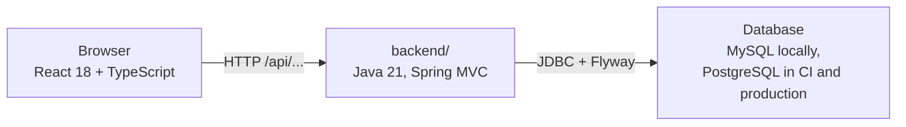

# chomiii

> **Chomiii is an open-source project with two complementary goals: to learn agentic engineering through practical experimentation, and to produce capable, reliable AI agents through disciplined software engineering.**

The repository is public; the predecessor repositories `chomi` and `chomii` remain untouched. The engineering contract for this project lives in [AGENTS.md](AGENTS.md).

Current status: **Milestone 0 (M0) — project foundation**. See [docs/roadmap.md](docs/roadmap.md) for the full plan and [docs/verification.md](docs/verification.md) for honestly recorded evidence of what has actually been checked so far.

## Architecture at a glance

Two independent processes with an explicit HTTP contract:



- **`backend/`** — Java 21, Spring Boot 3.5 with conventional Spring MVC. Data access is JDBC with [Flyway](https://www.red-gate.com/products/flyway/) versioned migrations (`backend/src/main/resources/db/migration`). Details in [docs/architecture.md](docs/architecture.md).
- **`frontend/`** — React 18 + TypeScript 5, built with Vite. It checks the backend health endpoint once on load and currently renders the `chomiii` wordmark. Details in [frontend/README.md](frontend/README.md).

Features are built test-first: a failing test specifies the behavior, then the smallest correct implementation, then refactoring. Architecture and trade-offs are explained in [docs/architecture.md](docs/architecture.md).

## Two databases, one migration set

Chomiii uses **MySQL for local development** and **PostgreSQL in CI and production**:

| Environment | Engine | Notes |
| --- | --- | --- |
| Local development | MySQL | Any reachable local MySQL instance; default `jdbc:mysql://localhost:3306/chomiii` in [`application-local.yml`](backend/src/main/resources/application-local.yml); **no Docker required** |
| CI / production | PostgreSQL | CI runs the PostgreSQL Testcontainers suite — plus a real MySQL 8 job for dialect parity; the `prod` profile requires a PostgreSQL JDBC URL from the environment |

The consequences in practice:

- **Migrations must stay portable.** SQL in `db/migration` must be vendor-compatible across MySQL and PostgreSQL, or shipped as vendor variants (e.g. Flyway database-specific locations such as `classpath:db/migration/{vendor}`). Never hand-edit schemas outside migrations.
- **Both engines need verification.** The local MySQL + Flyway suite and the CI PostgreSQL suite are both part of proving a change; neither engine is a second-class citizen.
- **Environment differences stay explicit.** The engine is chosen by configuration (see below), never silently.

## Configuration contract

The database engine is selected by Spring profile — **nothing is configured from `.env` files**, and Spring Boot does not read any `.env` file automatically:

| File | Role |
| --- | --- |
| `backend/src/main/resources/application.yml` | Shared settings; the **default profile is `local`** (local is chosen unless you opt out explicitly) |
| `backend/src/main/resources/application-local.yml` | **Local development, MySQL.** Default JDBC URL `jdbc:mysql://localhost:3306/chomiii` — only the URL is defaulted, credentials always come from the environment |
| `backend/src/main/resources/application-prod.yml` | **Production, PostgreSQL.** `SPRING_PROFILES_ACTIVE=prod` with a `jdbc:postgresql://HOST:5432/DATABASE` URL — URL and credentials are required from the environment, with **no defaults** |
| `backend/src/test/resources/application-ci.yml` | CI/test profile: sets no datasource deliberately — the Testcontainers PostgreSQL container supplies the connection |

For local development you normally only set credentials (and can override the URL through the same variables):

```powershell
$env:CHOMIII_DB_USER     = "<your-local-mysql-user>"
$env:CHOMIII_DB_PASSWORD = "<your-local-password>"
# optional: $env:CHOMIII_DB_URL = "<a JDBC URL other than the default in application-local.yml>"
```

⚠️ **No real credentials ever live in files.** `.env.example` documents placeholders only — see below — and production values belong to the deployment's secret store, never a file in this repository.

## Health endpoint

The frontend and local checks use one contract, backed by tests on both sides:

```
GET /api/health   ->   200 { "status": "UP", "service": "chomiii" }
```

Errors follow the same shape everywhere via RFC 7807 problem details — see [docs/architecture.md](docs/architecture.md).

## Local prerequisites (no Docker)

| Tool | Used for | Notes |
| --- | --- | --- |
| JDK 21 | Backend | Check with `java -version`; Maven is included via the Maven Wrapper |
| MySQL | Backend local run + local integration suite | Any reachable local instance; create the `chomiii` schema and a dedicated user |
| Node.js + npm | Frontend | LTS; Vite dev server, Vitest, Playwright |
| Git | Everything | |

Docker is **not** a local prerequisite. The default `./mvnw verify` (PostgreSQL Testcontainers) needs Docker and is the CI path — you do not need Docker to build, test, run, or pass the local MySQL integration suite. See [docs/testing.md](docs/testing.md) for which command needs what.

## Local setup (Windows PowerShell)

### 1. Create local MySQL databases and set credentials

Using your MySQL administration tool, create separate databases for development and integration tests:

```sql
CREATE DATABASE chomiii;
CREATE DATABASE chomiii_test;
```

Grant a local development user access to these databases. The test database must be disposable; Flyway writes its migration history there.

Configuration lives in the Spring profile files (see [Configuration contract](#configuration-contract)); you only supply credentials. The local MySQL URL default of `jdbc:mysql://localhost:3306/chomiii` is set in [`backend/src/main/resources/application-local.yml`](backend/src/main/resources/application-local.yml):

```powershell
$env:CHOMIII_DB_USER     = "<your-local-mysql-user>"
$env:CHOMIII_DB_PASSWORD = "<your-local-password>"
```

To make them persist for future sessions, use `setx` (new terminals only) or set user/system variables in Windows settings. Command-line-only values are the safest default for development. For production values under the `prod` profile, use the deployment's secret store — never a file in this repository.

### 2. Backend

Run from `backend/` (the Maven Wrapper lives there):

```powershell
cd backend
.\mvnw.cmd clean test            # focused unit + MVC slice tests; no database needed
$env:CHOMIII_DB_URL = "jdbc:mysql://localhost:3306/chomiii_test"
.\mvnw.cmd -Plocal-mysql verify  # real MySQL + Flyway integration suite; no Docker
$env:CHOMIII_DB_URL = "jdbc:mysql://localhost:3306/chomiii"
.\mvnw.cmd spring-boot:run       # start the API on http://localhost:8080
```

Check it is up:

```powershell
Invoke-RestMethod http://localhost:8080/api/health
# status : UP
# service : chomiii
```

(`./mvnw verify` without the profile runs the PostgreSQL Testcontainers integration tests instead and requires Docker — that is the CI-shaped check, not the local one. The local MySQL suite runs `BackendMySqlLocalIT` against the database reached through `CHOMIII_DB_*`.)

### 3. Frontend

Open another terminal at the repository root:

```powershell
cd frontend
npm ci                  # install exactly what the lockfile pins
npm run dev             # Vite dev server; /api is proxied to the backend (BACKEND_URL, default http://localhost:8080)
npm run lint            # ESLint (strict, typescript-eslint)
npm run typecheck       # tsc --noEmit, strict
npm run test            # Vitest + React Testing Library unit tests
npm run build           # typecheck + production build to dist/
npm run test:browser    # standalone Playwright suite (no backend needed)
npm run test:browser:integration   # real frontend↔backend browser test — requires the running backend
```

The dev server proxies `/api` to the backend, so development needs no CORS. See [frontend/README.md](frontend/README.md) for the backend-URL configuration contract.

## Continuous integration

The CI workflow lives in [.github/workflows/ci.yml](.github/workflows/ci.yml): secret scanning, backend unit + PostgreSQL Testcontainers/Flyway with JaCoCo and an OWASP dependency scan, a real MySQL 8 job for migration-dialect parity, frontend lint/typecheck/unit/build/audit, and an E2E job that boots the jar against real PostgreSQL under the `prod` profile and runs both Playwright suites. The first run was blocked by an account billing issue before any job started; see [docs/verification.md](docs/verification.md).

## Roadmap

Milestones M0–M7 — only M0 has implemented work; everything below it is plan, kept honest against [docs/verification.md](docs/verification.md):

| Milestone | Theme |
| --- | --- |
| [M0](docs/roadmap.md#m0--foundation-current-partially-implemented) | Foundation: public repo, architecture, TDD, CI (current — only milestone with implemented work) |
| [M1](docs/roadmap.md#m1--chat) | Chat: Gemini first, BYOK, hosted multi-turn streaming chat, conversation persistence, accounts/session boundaries; Pstack workflows start here |
| [M2](docs/roadmap.md#m2--memory) | Memory: user-scoped persistent memory; Agent Beacon evaluated first; remember/retrieve/correct/delete/isolate, provenance and consent |
| [M3](docs/roadmap.md#m3--agent) | Agent: tool registry/calls, bounded loop, permissions/approval, trace, timeout |
| [M4](docs/roadmap.md#m4--integrations) | Integrations: Gmail, Calendar, search, MCP — documented APIs only |
| [M5](docs/roadmap.md#m5--durable-autonomy) | Durable autonomy: tasks, scheduling, retries, cancellation, recovery/idempotency/history |
| [M6](docs/roadmap.md#m6--south-african-workflows) | South African workflows: budgeting in rand, shopping, transport, WhatsApp (after API research), multilingual/regional |
| [M7](docs/roadmap.md#m7--consumer-maturity) | Consumer maturity: onboarding, reliability, privacy, cost, auth, ops; hosted + self-hosting |

Pstack is noted in [docs/references.md](docs/references.md): its engineering workflows (TDD cadence, verification-before-merge) become the working discipline from **M1** onward. It is not an M0 prerequisite, and no Pstack work is happening now.

## Security expectations

Never commit credentials, API keys, tokens, personal data, or production environment files. [`.gitignore`](.gitignore) excludes `.env*` except `.env.example`, which itself must contain **placeholders only**. Report vulnerabilities per [SECURITY.md](SECURITY.md).

## Documentation

| Document | Contents |
| --- | --- |
| [docs/architecture.md](docs/architecture.md) | How backend and frontend fit together, dual-database layout, HTTP contracts, package layout |
| [docs/roadmap.md](docs/roadmap.md) | Milestones M0–M7 with acceptance criteria |
| [docs/testing.md](docs/testing.md) | Test-first workflow and every test/verification command, local and CI |
| [docs/references.md](docs/references.md) | Study references: Pstack, Agent Beacon, Spring AI, LangChain4j, Mem0, Letta, LangGraph, OpenHands, LibreChat |
| [docs/verification.md](docs/verification.md) | Observed evidence: what was actually run and what was not |
| [CONTRIBUTING.md](CONTRIBUTING.md) | How to contribute |
| [SECURITY.md](SECURITY.md) | Security policy and how to report vulnerabilities |

## License

[MIT](LICENSE) — © 2026 Chomiii contributors.
