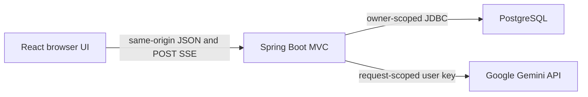

# chomiii

Chomiii is an open-source chat application built with Java 21, Spring Boot,
React, TypeScript, and PostgreSQL. Milestone 1 adds real Gemini conversations
with a user-supplied API key. The existing public repository is
[leeroy-chakanyuka/chomiii](https://github.com/leeroy-chakanyuka/chomiii).

You can select a Gemini model, stream its response, return to earlier chats,
and continue with the same conversation context. Messages live in PostgreSQL.
The browser keeps your Gemini key in memory by default. You can choose
**Remember this key on this device** to restore it after a reload. The saved
copy is encrypted in your browser profile, but the decryption key is stored
there too. This is convenience storage, not protection from a compromised
browser or another app served from the same local origin. **Remove key** deletes it. Get a key at
[Google AI Studio](https://aistudio.google.com/apikey). Your Google account
controls provider limits and any charges.



Chomiii has a **small, versioned general-purpose runtime identity**. It does
not yet include accounts, executable tools, autonomous action loops, background
tasks or long-term personal memory. Anonymous conversations belong to one browser cookie. They do not sync
between devices, and losing the cookie loses access to them. See
[docs/roadmap.md](docs/roadmap.md) for later milestones.

## M2 review PR: personal memories

[PR #3](https://github.com/leeroy-chakanyuka/chomiii/pull/3) introduces
a **Memories** panel where people can deliberately save, inspect, edit and
delete preferences or commitments. The PR's backend stores owner-scoped
records in the existing database and selects up to three relevant memories
for future chats without another inference request. The chat screen has a
**Use saved memories** checkbox to opt out of using saved facts.

This is **not** automatic memory extraction, cross-device accounts, or
permission to take actions. The existing anonymous cookie owns the saved
records: losing it may lose access. Relevant memories sent to the model
provider are subject to that provider's data handling; memory entries remain
plaintext in the app database. Do not store passwords, access keys or payment
details. Deleting a memory does not delete similar facts previously typed in
chat messages or copies already supplied to a model provider.

Read [M2 research](docs/m2-research.md), [design and limitations](docs/m2-design.md)
and [verification](docs/verification.md) before treating M2 as complete.

## Product direction and context (M1.5)

Chomiii is a **general-purpose personal assistant for everyday people**, not a
coding agent. The first goal is a fast, straightforward chat experience; personal
memory, task-specific workflows and real actions arrive in later milestones.

Java loads the compact, trusted [SYSTEM.md](backend/src/main/resources/agent/SYSTEM.md)
once at application startup. It does not load skills or run a classification
model before a normal chat response. The [context strategy](docs/context.md)
describes how the current message and owner-scoped conversation history are
assembled, and what richer context must wait for user-controlled memory.

Read the [product vision](docs/product-vision.md), [target architecture](docs/agent-architecture-plan.md),
[lessons from other agents](docs/agent-landscape.md), and
[revised roadmap](docs/roadmap.md). These distinguish **implemented behavior**
from the future agent design.

## Start on Windows

Install Java 21 and Node.js 22 or newer, then double-click
`start-chomiii.bat` in the repository root. On first run, the launcher
installs its dependencies and creates a local PostgreSQL database. It opens
the app at <http://127.0.0.1:5173/> and shows backend output in the command
window. Keep that window open while using the app; press Ctrl+C to stop it.

Your local database and its database-only credentials live under
`%LOCALAPPDATA%\chomiii`, outside the repository, and survive launcher
restarts. The launcher does not save or supply your Gemini API key. A running
service on port 8080 or 5173 must be stopped before starting another copy.

## Run the stack with Docker

Docker Compose runs PostgreSQL, the Java API, and a frontend that proxies
`/api` to the backend. PostgreSQL uses a named volume. Set a password in your
shell, then run the following commands from the repository root:

```powershell
$env:CHOMIII_DB_PASSWORD = '<your-local-postgres-password>'
docker compose config
docker compose up --build -d
docker compose ps
docker compose logs --tail=100
```

Open <http://localhost:5173>. Enter your own key and choose a model. `docker
compose down` stops the stack without removing conversation data. Do not use
`down -v` if you want to keep that data. No Gemini key is placed in the Compose
file or container image. Docker was unavailable on the machine used for M1, so
the Compose startup and restart smoke checks remain unverified. See
[docs/verification.md](docs/verification.md).

## Run the backend and frontend separately

The backend requires Java 21 and a reachable PostgreSQL or MySQL database.
M0's default `local` profile targets MySQL; set `CHOMIII_DB_URL` to use
PostgreSQL instead. Flyway applies the same migrations to either engine.
Start the backend from `backend/`:

```powershell
$env:CHOMIII_DB_URL = 'jdbc:postgresql://localhost:5432/chomiii'
$env:CHOMIII_DB_USER = '<your-local-db-user>'
$env:CHOMIII_DB_PASSWORD = '<your-local-db-password>'
.\mvnw.cmd spring-boot:run
```

The backend serves `GET /api/health` at `http://localhost:8080`. To use the
default local MySQL profile, omit the URL override and create the `chomiii`
database first. The MySQL default is `jdbc:mysql://localhost:3306/chomiii`.

In another terminal, start the frontend from `frontend/`:

```powershell
npm ci
npm run dev
```

Open <http://localhost:5173>. Vite forwards `/api` to
`http://localhost:8080`. To use another backend port, set `BACKEND_URL` before
starting Vite. The `VITE_API_BASE_URL` build-time override is for deployments
with a same-origin reverse proxy; a cross-origin backend needs additional CORS
and cookie configuration.

The hosted `prod` profile requires a PostgreSQL JDBC URL, database
credentials, and `CHOMIII_PUBLIC_ORIGIN` set to the HTTPS browser origin.
Put the backend behind a trusted HTTPS reverse proxy on a private network.
The proxy must replace client-supplied forwarding headers. Never publish
credentials or filled-in `.env` files. [`.env.example`](.env.example) lists
the configuration names.

## Verify locally

```powershell
# From backend/
.\mvnw.cmd test
# With a disposable local MySQL database and CHOMIII_DB_* set:
.\mvnw.cmd -Plocal-mysql verify

# From frontend/
npm run lint
npm run build
npm run test
npm run test:browser
# With a running backend and CHOMIII_PUBLIC_ORIGIN=http://127.0.0.1:5175:
npm run test:browser:integration
```

The PostgreSQL API tests run locally when `CHOMIII_DB_URL` points to an
isolated PostgreSQL database. The opt-in `GeminiLiveTest` makes one real model
call when you set `GEMINI_API_KEY` and `CHOMIII_RUN_GEMINI_SMOKE=true`. The
separate opt-in Playwright live-chat test needs a running backend,
`CHOMIII_RUN_LIVE_CHAT=true`, and the same key. The ordinary test suite does
not use paid model calls. See [docs/testing.md](docs/testing.md) for commands
and [docs/verification.md](docs/verification.md) for the results actually
observed during M1.

The [API reference](docs/api.md) documents requests, streaming events,
sessions, error codes, and cancellation. [Architecture](docs/architecture.md)
explains the provider boundary and context policy. [AGENTS.md](AGENTS.md)
contains the engineering contract. Chomiii is licensed under [MIT](LICENSE).
