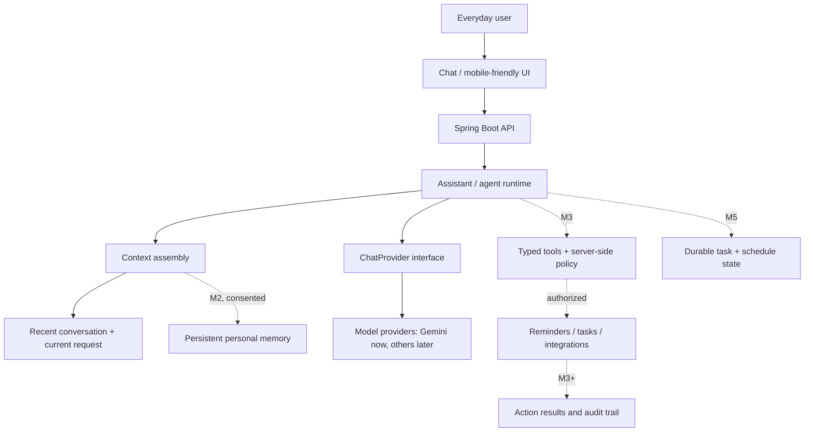

# Target architecture — a personal assistant becoming an agent

This is a **directional architecture**, not a claim that all components exist. Chomiii keeps a Java 21 Spring Boot backend and a React frontend. We should build the smallest working slice of each capability before adding new frameworks.

## One runtime, multiple capabilities

The user describes an outcome, not a command pipeline. A single backend runtime owns a conversation turn and decides whether it can simply answer, whether it needs relevant context, and—at later milestones—whether a typed tool is appropriate.

**What exists today (M1):** Spring MVC controllers, owner-scoped conversation history in PostgreSQL/MySQL, a provider boundary for Gemini, streaming over SSE, cancellation, and local request concurrency limits. This is still a chatbot, not an executing agent.

**M1.5 scope:** a small versioned identity and explicit context-selection contract (see [context.md](context.md)). Prompt construction stays separate from the trusted user-message field. No additional inference call for routing ordinary requests.

**M2:** owner-scoped personal memory with source, consent, correction, retrieval budget, and deletion semantics. Existing conversation storage is not synonymous with long-term memory.

**M2.5:** task-oriented, progressively disclosed skills only when a *real workflow* warrants them, preferably alongside appropriate capabilities. Ordinary summarization, writing, and debugging are not automatically separate skill plugins.

**M3:** tool schemas, a bounded model/tool loop, Java-enforced permissions and approvals, cancellation, and trace records. Start with a small harmless action rather than a general shell or browser.

**M4:** permitted connections to calendar, email, search, and external services.

**M5:** durable tasks, scheduling, idempotent retries, interruptions, and opt-in progress updates.

## Boundaries that cannot be replaced by instructions

| Boundary | Owner | Invariant |
| --- | --- | --- |
| System identity | Packaged app resource | Short, versioned, never writable through user text |
| Conversation context | Java chat layer | Owner checked, role tagged, budgeted, untrusted outside system content |
| Personal memory | M2 memory service | User-scoped, permissioned, provenance-aware, correctable/deletable |
| Model inference | `ChatProvider` adapter | Provider-specific SDK and errors stay outside business logic |
| Tool execution | M3 tool registry | Known typed actions only; never treat model output as authority |
| Approval | M3 server policy + UI | Bind consent to the exact proposed action and arguments |
| Durable work | M5 task service | Restart-safe progress; no double execution on retries |

## Flow of an ordinary turn

1. Authenticate the browser/session and check the conversation owner.
2. Store the requested turn and prevent duplicate active submissions.
3. Assemble the minimum trusted identity plus authorized, relevant conversation context.
4. Request **one** streamed model response through `ChatProvider`.
5. Stream user-visible deltas promptly; finalize persistence after generation.
6. In the future, when an action is proposed, pause for server-side policy/approval and report the real outcome.

When tool execution is added, it must be bounded by steps, time, budget, and permissions. A model must not be able to authorize itself.

## Why not copy other agents wholesale?

OpenDot's single-process Python architecture, OpenClaw's long-running gateway, and Muse's distributed packages solve different operational problems. Chomiii already has a compact Spring Boot/React architecture. The *boundaries* and *experience* are transferable; the tech stacks, per-agent desktop sandboxes, and large infrastructure are not first-milestone requirements.

## North-star coordination without architecture inflation

One ordinary-language request can span calendars, email, memories, groceries
and priorities. The core runtime should **plan the required sequence**, but
the separate capability boundaries own each fact and side effect. The model
may propose a message, grocery cart or schedule change; server-side policy
checks the exact recipient, amount, destination and permission. The backend
records each attempted/resulting action so that cancellation or restart
cannot silently double-send or double-order.

This is a **future M3–M5 requirement**, not justification for building a
general browser, cloud VM or multi-agent swarm in M1.5. The staged concrete
scenarios are in [experience evaluation](design/experience-evaluation.md).

## Performance rules

Keep stable trusted instructions compact and consistent to make provider-side caching possible where supported. Do not attach an entire skill library, complete chat transcript, or every memory on each turn. Do not make a second model call just to classify an everyday message. A slow/unavailable memory service must not block the core response. Measure front-end paint, server queue/DB, and provider first-token times separately.

See [agent-landscape.md](agent-landscape.md), [context.md](context.md), and [perf/README.md](perf/README.md).
