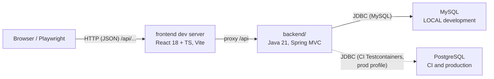

# Architecture

This document describes milestone **M0** and the reasoning behind its architecture. Planned milestones live in the [roadmap](roadmap.md).

## Shape

Chomiii is a **two-process application in one repository**, with each process independently buildable and testable. The database engine depends on the environment:



The frontend never contains backend business logic; the backend owns all data and rules and exposes them over an explicit HTTP contract. The two halves are loosely coupled on purpose: either can be rebuilt without touching the other, as long as the contract holds.

## Backend (`backend/`, Java 21)

- **Spring Boot 3.5.6**, conventional **Spring MVC** (`spring-boot-starter-web`) — synchronous, servlet-based, no speculative frameworks.
- **`spring-boot-starter-jdbc`** (plain `JdbcTemplate`) with **Flyway** versioned migrations at `src/main/resources/db/migration`. Baseline migration `V1__establish_baseline.sql` proves the Flyway pipeline on every environment; application migrations start at V2.
- **Dual-database strategy**:
  - **Local development: MySQL.** The default profile is `local` (set in `application.yml`), whose datasource lives in `application-local.yml` with the URL default `jdbc:mysql://localhost:3306/chomiii` — **no Docker involved**.
  - **CI and production: PostgreSQL.** CI runs the PostgreSQL Testcontainers suite (`BackendDatabaseIT` via the `ci` test profile in `src/test/resources/application-ci.yml`); the `prod` profile's datasource in `application-prod.yml` requires a `jdbc:postgresql://HOST:5432/DATABASE` URL from the environment, with **no default**. CI additionally runs the migration suite on a real MySQL 8 service for dialect parity.
  - **Portability rule:** migration SQL stays vendor-compatible across both engines, or is shipped as vendor variants (e.g. Flyway database-specific locations such as `classpath:db/migration/{vendor}`). Both engines are first-class verification targets; neither is a second-class engine only exercised in CI.
- **Configuration contract**: `CHOMIII_DB_URL`, `CHOMIII_DB_USER`, `CHOMIII_DB_PASSWORD` as plain environment variables; the URL default lives in `application-local.yml`, and `application-prod.yml` demands all three explicitly. `.env.example` documents placeholders; **nothing loads a `.env` file automatically** — Spring Boot reads the profile files.
- **Package layout**, feature-oriented: `com.chomiii.health` (the health endpoint), `com.chomiii.error` (the shared error contract), `com.chomiii` (application bootstrap/config). Controllers are thin; behavior lives in services and records; dependencies flow one way via constructor injection.
- Runs by default at **http://localhost:8080**.

## Frontend (`frontend/`, React 18 + TypeScript 5.7 + Vite 6)

- Minimal shell for M0: renders the lowercase `chomiii` wordmark and performs **one** backend health check on load.
- Health-check states, strictly validated against the contract: `checking…` (`data-state="loading"`), then `up` (`data-state="up"`) on a matching response, or `unavailable` for any non-OK status, malformed JSON, wrong payload shape, or connection failure — without crashing the app.
- **Development proxy**: Vite forwards `/api` to the backend origin (`BACKEND_URL`, default `http://localhost:8080`), so browser requests stay same-origin and need no CORS.
- **Build-time override**: `VITE_API_BASE_URL` points a production build directly at another origin, which requires backend CORS or a same-origin reverse proxy (neither exists yet) — otherwise the shell correctly shows `unavailable`.
- Details and commands: [frontend/README.md](../frontend/README.md).

## HTTP contracts

### Health

```
GET /api/health

200 OK { "status": "UP", "service": "chomiii" }
```

Defined by backend tests (`HealthMvcTest`, `HealthServiceTest`, `HealthControllerTest`), asserted again in frontend unit tests (`src/App.test.tsx`) and browser tests. `/api` is the reserved prefix for every API endpoint.

### Errors — RFC 7807 problem details

All errors share one shape, enforced by `com.chomiii.error.ApiExceptionHandler`:

- Spring MVC built-in failures (400 malformed JSON, 404 unknown path, 405 wrong method, 415 unsupported media type, validation failures) keep their **native status** in a problem-detail body; unknown paths get the title `Resource not found`, validation failures add an `errors` property.
- Anything an `@ExceptionHandler` does not claim falls through to a 500 problem detail titled `Internal server error`. The log records the exception type without its message or stack trace, which may contain sensitive data.

The frontend treats anything that does not match the health contract as `unavailable`, so error shape changes cannot crash the shell.

## Testing boundaries (summary)

Unit and MVC-slice tests run without any database. Database-backed checks come in two vendor flavors: the local **MySQL + Flyway** suite (`mvnw -Plocal-mysql verify`, no Docker) and the **PostgreSQL** Testcontainers suite (`mvnw verify`, Docker — the CI path). See [testing.md](testing.md).

## Principles

From [AGENTS.md](../AGENTS.md): clarity over cleverness, small dependencies, no speculative distributed systems, no unnecessary frameworks, and engine differences kept explicit rather than papered over. New features start as failing tests; explain consequential architectural choices and their trade-offs here.
