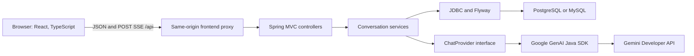
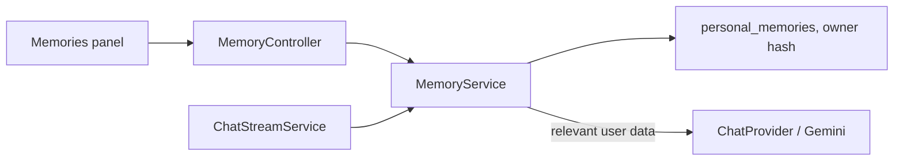

# Architecture

Chomiii keeps the M0 Java 21 Spring Boot MVC backend and React and TypeScript
frontend under `backend/` and `frontend/`. The browser calls the API through a
same-origin Vite or Nginx proxy. The backend owns conversation persistence,
context construction, and access to Gemini. See [api.md](api.md) for the wire
contract and [verification.md](verification.md) for observed M1 results.

## Conversation and provider data

Flyway V1 is the M0 baseline. V2 creates `browser_sessions`, `conversations`,
and `messages`. `conversations` has a UUID, hashed session owner, title,
timestamps, and one active request ID. `messages` has a UUID, ordered sequence,
request ID, role, content, status, and timestamp. Database constraints enforce
valid roles and states, message ordering, and one user and assistant message
per request. Deleting a conversation cascades to its messages. The migration
and API were exercised on PostgreSQL 17 and MySQL 8. The `local` profile still
defaults to MySQL; Compose explicitly supplies a PostgreSQL JDBC URL. The
`prod` profile requires PostgreSQL credentials from the environment.

`ChatProvider` accepts a model, a distinct system instruction, and ordered
role-tagged messages. It opens a cancelable stream of text deltas. The Gemini
adapter owns the Google GenAI SDK, translates provider errors, and creates a
client for each supplied key. No global mutable key exists. The provider
catalog lists configurable models, but Google may deny a model for a given
key. Such a rejection is reported rather than switching models. M2 can use
the typed conversation messages and provider port without importing Gemini
SDK types into a future memory module.

## Stream lifecycle

`ChatTurnStore.begin` checks the owner and claims an idle conversation in one
transaction. It writes the complete user message and a pending assistant
message before provider execution. The request ID has a unique constraint,
and retries or overlapping sends return 409 without duplicating the turn.
A bounded executor relays provider chunks to the POST SSE response; the reply
is saved once at completion. A failed or canceled generation records a failed
or interrupted assistant message with any partial text. An explicit stop
endpoint cancels a provider blocked waiting for another chunk. On a process
restart, pending assistant messages become interrupted and conversation claims
are cleared. M1 assumes one backend instance. It does not replay an
interrupted stream.

`ContextWindow` chooses at most 20 messages (including the current user message)
within 16,000 Java string characters, prioritizing the newest complete history. It preserves message
order and role and excludes failed or interrupted assistant messages. It reads
only the owner-checked conversation. The M1.5 prompt layer loads only the
short versioned `agent/SYSTEM.md` from the Java classpath at startup. User
text stays in the user role, never in the trusted system instruction. The
memory service adds bounded personal context as a separate user-role message.

The conversation-history selector uses a character budget rather than model
tokens. See [context.md](context.md) for the history policy and context limits.

## Browser sessions and credentials

The backend issues a cryptographically random anonymous-session token in an
HttpOnly, SameSite=Lax cookie and stores only its SHA-256 hash. In production,
the cookie is Secure and `__Host-` prefixed. Every conversation lookup checks
the hash. Mutations require the configured `Origin`; the production profile
requires HTTPS. Backend traffic must stay on a private network behind a proxy
that replaces client-supplied forwarding headers. Conversation responses set
`Cache-Control: no-store`.

By default, the frontend keeps the Gemini key in React memory and clears it
on reload. The optional remember setting encrypts it with a non-extractable
Web Crypto key and stores the ciphertext and CryptoKey in browser IndexedDB.
The same browser origin can decrypt it; this is not a passphrase-protected vault.
The key goes only in a request header to the backend. Remove key deletes the
browser record. The backend never persists the key or returns upstream exception messages. The
local single-instance limiter allows 60 requests per minute per established
browser session and limits session creation by IP. At most eight generations
run at a time. A distributed rate limiter, stronger authentication, and
server-side key management are outside M1.

The bundled Nginx config disables `/api` access logging. Hosted proxies must
also avoid logging the `X-Gemini-Api-Key` header or request bodies. Do not
enable credential-bearing request traces on the Java server.

Anonymous cookies expire after 180 days. A browser reload retains the cookie
and access to its memories. Users cannot reopen their chats or memories if
the cookie is removed or expires. Sessions do not sync between devices, and
expired-session data has no automated retention cleanup yet. Reassess abuse
prevention, data retention, and privacy before a widely accessible service.

## Why these boundaries

Spring MVC's `SseEmitter` streams over the existing servlet stack without
adding WebFlux. Request-scoped SDK clients prevent key sharing across users.
Persisting initial and terminal states avoids a database write for each
stream chunk while preserving interrupted work. PostgreSQL is authoritative
for local M1 verification and production, while portable SQL keeps the M0
MySQL development path usable. Docker Compose defines the three local
services, but Docker was not installed on the verification machine. No
container startup result is claimed in [verification.md](verification.md).

## Target evolution (proposal, not implemented)

The current diagram above shows M1. The future design in
[agent-architecture-plan.md](agent-architecture-plan.md) places one Java agent
runtime between the interface and separate services for context, consented
memory, inference, permitted tools and durable tasks. A tool must be authorized
by the backend rather than by prompt wording. The user sees a simple personal
assistant, not the underlying implementation.

See [product-vision.md](product-vision.md) and [agent-landscape.md](agent-landscape.md)
for everyday-user requirements and the design lessons we intend to adopt.

## M2 implementation under review (PR #3)

[Memory research](m2-research.md) selects a small native service rather
than Beacon/third-party memory infrastructure. The owner-scoped
`personal_memories` Flyway V3 table stores explicit user-saved facts.
`MemoryController` exposes inspectable CRUD, `MemoryService` enforces
limits and ownership, and `MemoryRetrieval` ranks lexical and topic matches.
`ChatStreamService` supplies selected records
as a **user-role context message** before the current request; these
records are not part of the system prompt and grant no tool privileges.

Memory identity follows the existing anonymous cookie, not a named cross-device
user. Lexical retrieval makes a local database read. Optional embedding indexing
can make additional provider calls after a reply. The M2 acceptance and
retention requirements are outlined in [M2 design](m2-design.md).

The session filter also protects `/api/memories`, applying the same owner,
origin, and no-store rules as conversation requests. Before storing a chat
turn, the backend reads the owner's memory revision. Manual memory changes
increment that revision, so an older extraction cannot restore a deleted or
corrected memory. The separate extraction worker cancels its Gemini request
after 120 seconds. A failed memory lookup leaves chat available without
memory context.

## Evaluation harness

The evaluation code is test-scoped under `backend/src/test/java/com/chomiii/evaluation`.
Versioned synthetic fixtures live in `evals/`. The same runner uses either an
in-memory test store or the real Spring and JDBC services on an explicitly
disposable local database. The database URL and Flyway target are pinned to the
validated test database before Spring starts. A provider wrapper counts and
limits opt-in live calls, while the scorer remains independent of the Gemini
SDK. An optional separate-family judge or a human can review ambiguous matches.
The fixture contract describes expectations. The planner can invoke the internal
read-only memory search tool, but it cannot execute external actions.
See [evaluation instructions](../evals/README.md) for commands and limitations.

## M3.1 planning path

`ChatStreamService` routes explicit or locally recognized planning requests
through `PlanningService`. It retains the owner-checked conversation and
cancelable provider stream. `MemoryService.forPlanning` supplies the selected
active memory records in a lower-trust user message. The planner buffers model
JSON, and `PlanParser` checks IDs, limits, capability membership, and the
dependency graph before the service emits a structured event and readable
proposal. The capability catalogue describes future operations and contains
no execution functions. See [M3.1 design](m3.1-design.md) and the
[memory and planning flow](memory-planning-flow.md).

## Persistent profile and optional embeddings

Canonical `personal_memories` remain authoritative. Flyway V4 adds an
owner-scoped profile, categorized paragraphs, and their source memory IDs.
`MemoryService` refreshes those rows inside the canonical mutation transaction
under the owner's session-row lock. The profile records both the user's memory
revision and a content revision for accepted background learning. The original
memory revision continues to reject extraction results from before a correction
or deletion. Ordinary reads validate the revisions and source relationships
without regenerating the profile.

Chat and planning receive a bounded profile and selected facts as lower-trust
user data. The `memory.search` function can request additional approved facts.
The Gemini adapter sends native function calls and function responses in the
same generation. It retains provider continuation signatures only for that
request. The application does not persist those parts in chat history. The
tool has per-turn call, result, and execution-time limits. Recall off removes
the tool and the automatic memory context. Set
`chomiii.memory.search-tool.enabled=false` to disable the tool independently.

Flyway V5 adds a durable job and vector per canonical memory. The vector is a
JSON array of normalized 32-bit values stored in SQL `TEXT`, with the owner,
memory ID, content hash, model, dimensions, configuration, and timestamp.
JSON is portable and inspectable but uses more space and parsing time than a
binary float array. A future PostgreSQL deployment could use `pgvector` for
indexed nearest-neighbor search after corpus size and measurements justify
the database-specific dependency. The current implementation compares vectors
in Java and adds no vector database.

Embedding generation is disabled by default. Set
`chomiii.memory.embeddings.enabled=true` to permit indexing. Canonical changes
queue work in the same transaction, even when indexing is disabled. After a
successful recall-enabled chat, a bounded worker uses that turn's Gemini key
to process pending jobs for that owner. The key is never stored in the jobs.
After a restart, pending jobs remain available. An interrupted running job can
be reclaimed after its lease expires when that owner next completes a chat.
Retries stop after five attempts. A failure leaves lexical recall available.
Indexing is at least once: a crash after a provider response but before the
database commit can repeat that request. A ready vector is reused while its
content hash and embedding configuration match.

With embeddings enabled, `memory.search` can combine lexical ranking with
cosine similarity over compatible stored vectors. Automatic context attempts a
semantic lookup only for an explicit personal request with no lexical hit.
The query embedding has a one-second deadline. A bounded, two-minute cache uses
the owner hash, query hash, and embedding configuration as its key. Missing
vectors, provider errors, quota exhaustion, and timeouts fall back to lexical
results. The similarity threshold and ranking weights require evaluation.

The default provider requests 768 dimensions from `gemini-embedding-2` and
uses Google's asymmetric search prefixes. A model or configuration change makes
older vectors incompatible. To queue an owner's memories for the configured
model, send `POST /api/memories/reindex` with that browser's session cookie and
the normal origin header. Reindexing removes the owner's old vectors and queues
fresh jobs; a later eligible chat supplies the temporary provider key. Model
calls can use quota or incur charges under the user's Google project.
