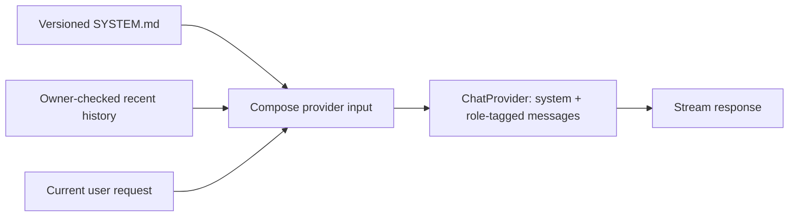

# Context strategy — M1.5 contract, M2 expansion

**What "context" means:** the minimum information Chomiii needs to understand *this* request correctly. Context is not synonymous with memory, a full transcript, or a giant prompt. The default should be **small, relevant, owner-authorized, and quick**.

## Context sources, trust and status

| Source | Trust boundary | M1.5 status | Later stage |
| --- | --- | --- | --- |
| Stable runtime identity (`SYSTEM.md`) | Trusted application resource | Loaded at app startup | Remains stable/versioned |
| Current user turn | User role, not system rules | Sent to provider | Same |
| Recent complete conversation history | Owner-scoped role-tagged data | Selected by `ContextWindow` | Improved token-aware selection |
| Personal preferences, commitments, facts | Constrained/consented user data | **Not implemented** | M2 |
| Notes, files, web results, app records | Untrusted source data | **Not implemented** | M2/M4 retrieval |
| Task state, action results, deadline changes | Verified backend state | **Not implemented** | M3/M5 |
| Date/time and app capabilities | Typed runtime context | **Not implemented** | Added only when needed |

## What the application actually does today

- `ChatStreamService` loads one packaged, short `agent/SYSTEM.md` identity; user content cannot edit it.
- `ChatTurnStore.begin` checks conversation ownership, writes the new user turn, and reads stored role/status-tagged history.
- `ContextWindow.select` includes the current user message and the **newest complete** conversation turns, at most **20 messages and 16,000 Java characters** in total; it excludes interrupted/failed messages and retains chronological order.
- This is a **character budget**, not a model token budget, and it does not summarize or retrieve older conversations. One browser cookie scopes existing histories; it is not a signed-in cross-device identity.
- Context construction is measured separately from store and provider latency. No memory search or classification LLM call is performed before streaming.

## M1.5 assembly contract

1. Trusted instructions have a stable order and a strict size limit; do not mix retrieved text into their role.
2. User requests and external content remain lower-trust context, even when they contain imperative instructions.
3. Use a bounded, deterministic selector before inference. The core experience must not depend on a second model call to choose an ordinary prompt skill.
4. Keep dynamic facts out of the stable prompt prefix when possible; avoid pretending today's date or capabilities are available if not supplied.
5. If context retrieval eventually fails or times out, **degrade gracefully** rather than blocking a response indefinitely.
6. Do not imply a fact is stored, current or verified without knowing its source.

## M2: proper personal memory

Store useful user-authorized context separate from transcripts. Require owner identity, consent/visibility, provenance, timestamps, correction and deletion. Retrieve the few facts relevant to the request; do not push every memory into every prompt. Distinguish what the person told us, what they approved us to save, and what the model inferred.

Before adopting Agent Beacon, Mem0, Letta, or a homegrown store, evaluate privacy, local/cloud flows, life-cycle deletion, isolation and latency against consumer needs. Agent Beacon starts as an **evaluation candidate**, not an assumed fit: it is oriented toward coding-agent traces and lessons.

## M2.5: skills and task-specific context

A skill is useful only when it adds tested workflow value, such as an appointment planner or budgeting flow with structured inputs and later real tools. Do not require users to type `/skill` or select a generic "writing" plugin to do everyday tasks. Load only a relevant skill body, if any, and keep safety decisions in code rather than prompt prose.

## What to measure

- Base system-prompt size and response context size; move from Java characters to provider-aware token estimates when supported.
- Frequency of missing or irrelevant context, user corrections and false memory claims.
- Context assembly p50/p95 and provider first-text p50/p95 on matched prompts.
- Privacy correctness: no cross-owner recall and no leaked file or tool content in trusted instructions.
- Whether remembering a fact or loading a workflow **actually improves task completion**.

**Acceptance for M1.5:** documented context boundaries, short trusted identity, deterministic current-message/history separation, focused tests, and no extra pre-stream inference. M2 and M2.5 are plans, not features already available.
