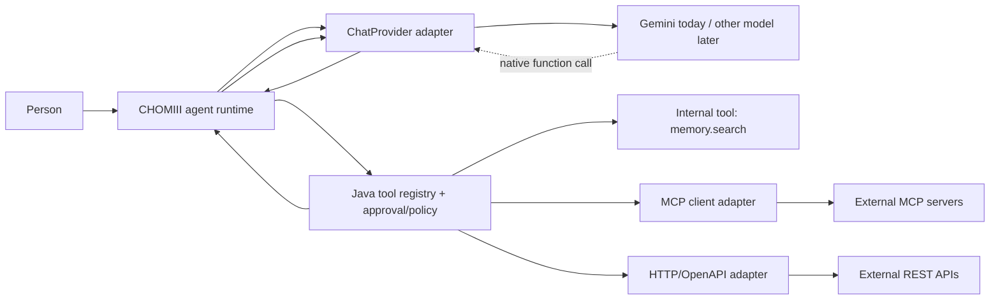

# External tool interoperability for CHOMIII — research, not implementation

**Research date:** 2026-11-11  
**Status:** Design reference only. No tool runtime, MCP integration, or external search connector is implemented by this document.

## Product goal and boundaries

**What:** Enable CHOMIII, a general-purpose assistant for everyday people, to use approved external tools without tying tool execution to Gemini's built-in products.

**Why:** A person might ask CHOMIII to find tonight's dinner options, check a calendar, or retrieve a personal preference. The provider should decide *what tool to request*; the Java application should decide *whether and how it can execute the request*. Switching Gemini to another model provider should not require rewriting every integration.

**For whom:** Nontechnical people who need simple outcomes, clear permissions, reasonable latency, predictable cost, and meaningful privacy controls.

**Success (future implementation, not claimed today):** A model can request one known typed tool, Java validates its arguments and owner permissions, an adapter retrieves an actual result, the model continues in the same conversation, and the user gets a useful answer. Switching the LLM or adding another external tool does not bypass policy or break existing tool contracts.

**Work already in progress elsewhere:** The user's coding agent is implementing `memory.search`. Do not duplicate, modify, or assume that code is finished based on this research. Internal memory search is a good reference tool for the eventual runtime, but this document concerns *external interoperable* tools.

See [target architecture](agent-architecture-plan.md), [context boundaries](context.md), [product vision](product-vision.md), and [engineering contract](../AGENTS.md).

## Terminology: three independent layers

1. **Model-native function calling:** Gemini, OpenAI, Claude, etc. produce a structured request for a tool with arguments. It is not execution. This layer uses provider-specific SDK message formats, signatures, call IDs, and streaming behavior.
2. **CHOMIII's tool contract/policy:** A Java-owned registry, typed input validation, user/owner scope, permissions, execution budget, cancellation, structured outputs, and action receipts. This should not import `com.google.genai` types.
3. **External tool transport:** An MCP client, a direct HTTP/OpenAPI adapter, or an internal service/repository call. Tools need not be proprietary or model-provider-hosted.

Do not confuse **Gemini's built-in Google Search** (executed on Google's servers) with a **custom `web.search` function** (requested by the model, executed by CHOMIII against a chosen search backend). A custom tool may still call a proprietary or paid third-party API; interoperability does not guarantee free cost, open-source servers, or user-data privacy.



## Candidate approaches

| Mechanism | Strengths | Limitations | Recommendation |
| --- | --- | --- | --- |
| Java native tools | Lowest ceremony; easy owner-scope and policy; good for `memory.search` | Must implement schema and execution conventions | First tool / reference implementation |
| Direct HTTP adapters documented by OpenAPI | Conventional Java HTTP clients; clear endpoint contracts; no MCP service required | Each API still needs auth, mappings, error handling, and often custom semantics | Prefer for one well-scoped, stable external API |
| MCP (Model Context Protocol) client | Discover tools, schemas, and call them across independently authored servers; open standardized protocol | Version compatibility, server trust, OAuth, prompt injection, latency, and complex lifecycle | Preferred general external-tool compatibility interface once base runtime is solid |
| Model-provider built-in tools | Minimal app-side execution for supported tasks | Model/provider-specific capabilities, data handling, availability and pricing | Optional provider feature, never the only external path |
| Browser/computer automation | Works where no service API exists | Fragility, access control, high-risk side effects and audit burden | Later milestone, not the first connector |

### MCP

MCP represents tool calls over JSON-RPC; clients discover capabilities and invoke named tools with typed arguments. Standard transports include local stdio and remote Streamable HTTP. The [official Java MCP client SDK](https://java.sdk.modelcontextprotocol.io/latest/client/) exposes client-side discovery and `callTool`, with synchronous and asynchronous usage.

**Protocol compatibility needs explicit testing.** The released [MCP 2026-07-28 revision](https://blog.modelcontextprotocol.io/posts/2026-07-28/) removed the old `initialize` handshake and protocol-level sessions, added `server/discover`, and changed remote interactions. The [2026-07-28 Streamable HTTP specification](https://github.com/modelcontextprotocol/modelcontextprotocol/blob/main/docs/specification/2026-07-28/basic/transports/streamable-http.mdx) describes a POST-oriented request transport without the previous GET stream endpoint. Do not implement a hardcoded 2025-11-25 flow and label it 2026-07-28-compatible.

The current [Java SDK client documentation](https://java.sdk.modelcontextprotocol.io/latest/client/) still demonstrates older version negotiation, `initialize()`, and older transports; other SDK documentation describes modern protocol support. **Confirm which release or snapshot of the Java SDK supports the 2026-07-28 protocol and negotiate explicitly with target servers** before committing to a dependency. Treat examples and libraries as version-scoped.

### OpenAPI / direct HTTP

[OpenAPI 3.2.1](https://spec.openapis.org/oas/v3.2.1.html), published September 10, 2026, is the current official specification at the research date. It describes HTTP endpoints independently of the model provider. CHOMIII can manually wrap one trusted operation as a typed tool without bringing in a generic OpenAPI-to-tool converter. A spec does not make an endpoint safe or authorize the model to call it; validate request parameters and scope server-side.

## Notes from the attached Google GenAI Java 1.80.0 research

The user's supplied read-only research inspected CHOMIII's `ChatProvider` and `GeminiProvider` and checked exact tagged Java SDK source. We independently inspected the [official Java SDK tag v1.80.0](https://github.com/googleapis/java-genai/tree/v1.80.0) as a follow-up.

**Existing seam:** `backend/src/main/java/com/chomiii/provider/ChatProvider.java` has `ChatInput` containing text-only role messages, and `Generation.stream(Consumer<String>)`. `GeminiProvider` calls `client.models.generateContentStream(...)` and currently reads text only. This cannot represent native function calls or reliably carry a model's returned state across tool turns.

**SDK-specific facts verified against tagged source:**

- Declare native functions through `FunctionDeclaration`, `Tool`, and `GenerateContentConfig.tools(...)`; use a proper schema, not instructions that ask the model to print JSON as a pretend tool call.
- `GenerateContentResponse.parts()` yields model parts and `functionCalls()` collects function-call parts; the latter can be nullable. A stream can contain text and function calls in the same model turn.
- `Part.functionCall()`, `Part.functionResponse()`, and `Part.thoughtSignature()` are available. `Part.thoughtSignature()` returns `Optional<byte[]>`; keep the original response parts and opaque signatures intact across the next `generateContentStream` request. Flattening the prior model turn to visible text loses necessary provider-native state.
- Build tool result parts with `FunctionResponse.builder().name(...).response(...)`, attaching the matching call ID when provided, then add them as user-role content following the intact model-role function-call parts.
- `FunctionDeclaration` documents dots as valid in a function name, so `memory.search` is permitted by the SDK schema. Prefer short names and test Developer API name validation on real supported models.
- Validate the model's argument map against an application-owned schema before execution. Model-returned arguments are data, not Java authorization.
- Handle `MALFORMED_FUNCTION_CALL`, empty responses, multiple calls, cancellation and timeouts deliberately. The current `chunk.text()` path is insufficient for tool turns and may throw on abnormal finish reasons.

The underlying references are [FunctionDeclaration.java](https://github.com/googleapis/java-genai/blob/v1.80.0/src/main/java/com/google/genai/types/FunctionDeclaration.java), [Part.java](https://github.com/googleapis/java-genai/blob/v1.80.0/src/main/java/com/google/genai/types/Part.java), [FunctionResponse.java](https://github.com/googleapis/java-genai/blob/v1.80.0/src/main/java/com/google/genai/types/FunctionResponse.java), and [Google's function-calling documentation](https://ai.google.dev/gemini-api/docs/function-calling).

**Potential provider seam (design, not code):** Provider adapter converts the model's *native* function request into a neutral `ToolInvocation(toolName, callId, arguments)`; a Java-owned policy/runtime checks it and dispatches it to internal, MCP, or HTTP adapters. Tool results return through the provider adapter, which retains the original Gemini model parts and signatures internally. If the provider owns the SDK continuation loop, it must call the application's policy/executor on every step, not independently authorize external effects. Keep maximum hops, cancellation and trace ownership in the shared runtime contract.

This is preferable to placing Gemini-specific `Content`/`Part` objects in memory repositories, tool implementations, or controller DTOs. Alternative: an opaque per-provider turn-state carrier if the orchestrator must persist or resume the model-native hop. That path is more complex and must not serialize private thought text.

## Recommended neutral tool contract (illustrative only)

```java
// Pseudocode: not existing project classes
record ToolDescriptor(
    String id, String description, Map<String, Object> inputSchema,
    boolean readOnly, boolean requiresApproval) {}

record ToolInvocation(
    String name, String providerCallId, Map<String, Object> arguments) {}

record ToolResult(
    String providerCallId, boolean success, Map<String, Object> output) {}

interface ToolAdapter {
    ToolResult execute(ToolInvocation call, ToolExecutionContext context);
}
```

`ToolExecutionContext` would contain trusted owner identity, exact connection authorization, request deadline, cancellation and a scoped execution/audit ID. It must come from Java's session/auth layer, **not model arguments**. A remote MCP tool may expose arbitrary names or schemas; CHOMIII should map only reviewed, allowed capabilities into the model's tool catalog, with stable aliases where necessary.

**Illustrative request lifecycle:**

1. Resolve current user/owner and permitted connections.
2. Offer only permitted, discoverable tool descriptions to the model.
3. Receive a provider-native function call; keep its opaque call ID/signature/order.
4. Validate tool name, JSON arguments, output caps and policy. For writes, request an explicit scoped approval on exact arguments before execution.
5. Execute approved adapter request; return structured output or structured error, with provenance and freshness.
6. Continue the same model turn using a native function response; never replace this with fake chat prose.
7. Bound total model/tool rounds, wall-clock time, token usage, rate limits and side effects. Record execution outcome, not an invented success.

## Security and privacy: research requirements

The [OWASP MCP Security Cheat Sheet](https://cheatsheetseries.owasp.org/cheatsheets/MCP_Security_Cheat_Sheet.html) identifies malicious tool descriptions/results, rug pulls, cross-server tool shadowing, prompt injection, excessive scopes and credential misuse. These matter more when an assistant gains mail, calendar, shopping or local-machine capabilities.

For future external integrations:

- **Allowlist** known servers and individual tools. Do not install or execute arbitrary MCP servers because the model asks for one.
- Treat remote tool metadata, prompts, retrieved text and outputs as *untrusted source content*, never as developer instructions.
- Validate arguments and output schemas in Java; cap output bytes and redact logs. Sensitive input supplied to a third-party tool is a privacy/consent decision, not a harmless internal context transfer.
- Isolate credentials by user, server and scope. Never forward a token for one service to another service (token passthrough).
- Remote endpoints need HTTPS, safe OAuth discovery/PKCE where applicable, SSRF protections, redirects and allowlisted hosts. Local stdio servers require process isolation and an explicit trust decision.
- Treat tool descriptions as versioned capabilities: review and detect changed schemas/descriptions before enabling newly available behavior.
- Treat read-only tools as lower risk, **not risk free**: search queries can leak private memories or contact names.
- Approvals for changes (send, reschedule, purchase, delete) must be tied to exact action arguments and evaluated by Java after the model proposes the call.
- Handle rate limits, offline connectors and retries without claiming success or repeating side effects. Cancellation of a waiting Java client is not proof that the external service stopped.
- Maintain a per-call audit trail and error category without collecting full raw personal content in logs.

## How to evaluate before choosing an MCP library

1. **No dependency (reference):** `memory.search` works through the internal Java registry. A mock model makes a native tool call and resumes without fake textual tool invocations.
2. **Direct HTTP:** A tiny, read-only demonstration against a trusted local fixture verifies request validation, timeouts, error results and provider independence.
3. **MCP client:** Against a known test server, verify discovery, JSON schema, calling, cancellations, resource cleanup, authentication and both sides' protocol versions. Do not expose arbitrary server-provided operations to the model.
4. **Provider swap:** Simulate a second `ChatProvider` adapter receiving and returning the same neutral `ToolInvocation` and `ToolResult`, without modifying the internal/MCP/HTTP adapters.
5. **Security:** Tool poisoning, malicious URL/metadata, cross-owner access, unexpected schema changes, credential leakage, and repeated write attempts must all fail safely.

Measure latency, tool discovery overhead, token cost of declarations, retries, additional model hops, and success/failure quality. Prefer one small external read-only integration before adding arbitrary connectors or a plugin marketplace.

## Research conclusion and milestone boundaries

**Recommended direction:** CHOMIII-owned typed tool registry/policy first; native model function calling isolated behind `ChatProvider`; direct HTTP adapters for specific stable APIs; **MCP client support as an interoperable extension**, not an architectural prerequisite for `memory.search`.

M3 establishes provider-native calling, typed execution and approval boundaries. M4 connects external services via HTTP/MCP. M3.4 remains the separate user-facing plan/execution UX revisit; M5 adds durable scheduled work. The work on `memory.search` should not be duplicated by this doc-only research.

**Open questions:** Which Java MCP SDK release genuinely supports 2026-07-28? Which local/remote server and auth profile will be the first approved test? How will multi-step provider-native state be persisted (if ever)? What per-tool privacy policy governs personal data passed to third parties?

## Sources / verification record

- [MCP 2026-07-28 release](https://blog.modelcontextprotocol.io/posts/2026-07-28/)
- [MCP 2026-07-28 Streamable HTTP spec](https://github.com/modelcontextprotocol/modelcontextprotocol/blob/main/docs/specification/2026-07-28/basic/transports/streamable-http.mdx)
- [MCP Java SDK client](https://java.sdk.modelcontextprotocol.io/latest/client/)
- [MCP Java SDK server](https://java.sdk.modelcontextprotocol.io/latest/server/)
- [OpenAPI 3.2.1](https://spec.openapis.org/oas/v3.2.1.html)
- [Google Gemini tool documentation](https://ai.google.dev/gemini-api/docs/tools)
- [Google Gemini function calling](https://ai.google.dev/gemini-api/docs/function-calling)
- [Google GenAI Java SDK 1.80.0 tagged source](https://github.com/googleapis/java-genai/tree/v1.80.0)
- [OWASP MCP Security Cheat Sheet](https://cheatsheetseries.owasp.org/cheatsheets/MCP_Security_Cheat_Sheet.html)

Research based on official public documents and the user's supplied read-only SDK investigation. No SDK implementation or live provider call was run for this note. Links can evolve; the protocol revision and research date above are intentionally explicit.
