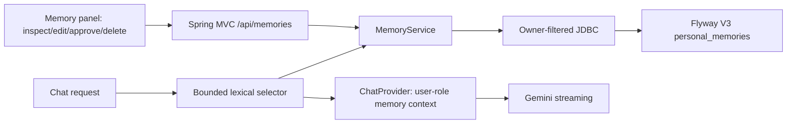

# M2: owner-scoped personal memory — implementation notes

This file describes **PR #3 (under review, not merged)**. The present Chomiii product is still a single-browser-session chat app; M2 does not add cross-device identity or real-world tools.

## Data and trust invariants

- `browser_sessions.owner_hash` (established in a secure HttpOnly cookie filter) owns each memory row by foreign key. Every read, update and delete includes `owner_hash`; clients cannot supply or override it.
- `source=user_explicit` means a person saved it manually. By default, a separate post-response extraction call can create `conversation_fact` (high confidence, active) or `inferred` (`suggested` until approved). These values carry a source-conversation reference, model-reported confidence, and timestamp. No model has direct database permissions.
- Hard limit 100 entries, 500 characters each; creating new entries locks the owner row before counting to prevent simultaneous writes from bypassing the limit.
- Editing replaces content; deletion removes the row; clear-all is owner scoped. The frontend asks for confirmation before bulk deletion. Updates do not leave an independent copy/history in this memory table.
- The model never receives credentials to query the memory store. The backend chooses at most three relevant memories under a strict character budget; their characters and one message slot are **reserved before** the recent chat window is assembled. The model receives them as **user-context data** before the current request, not as privileged system instructions.
- If retrieval has no match or fails, chat proceeds without those memories; no model call is made to classify or summarize memory before response generation. A user can opt out of injecting memories for their request.

## Product flow

1. Open **Memories** in the app (even while not connected to an AI key).
2. Naturally say "My usual groceries are milk and oats." After the completed reply, an automatic bounded extractor may save an evidence-backed fact without requiring a manual save. The user can also manually add a fact or correct what was learned.
3. Start a new chat and ask "What are my usual groceries?" A local selector may include that saved fact in the next model request.
4. Correct it in the manager; future requests see the updated entry. Delete it or clear all; future context retrieval no longer includes that memory.
5. Untick **Use saved memories** in chat to keep the saved entries out of that request. The setting is a browser-local preference, not a server-controlled memory read permission for external actors.

## Scope limitations and risks

Memory data is still plaintext in the existing DB; the 180-day cookie is not a persistent account identity. Deletion is **forward-looking**: a currently running model request may already have received old memory content. No revision history is retained after hard delete, and conversation messages and external provider logs require separate lifecycle policies. This is not a general-purpose secure personal-data vault.

Retrieval is lexical, not semantic, and may miss paraphrases. The `user_explicit` or `conversation_fact` source is not proof of truth, freshness, or permission for external actions. See [research decision](m2-research.md) and [memory contract](design/memory-contract.md).

## Implementation dependencies

No new runtime libraries. Uses Spring Boot MVC/validation/JDBC/Flyway, Java 21 and React/TypeScript already in the project. The typed tool loop and consented real-world actions remain M3; external apps remain M4.

## Verification to perform

- Backend focused: `./mvnw -Dtest=MemorySelectorTest,MemoryServiceTest,MemoryContextIntegrationTest,ChatIdentityTest test`
- DB-backed: set `CHOMIII_DB_URL` (MySQL or PostgreSQL) and run `./mvnw -Dtest=MemoryDatabaseTest,ChatStreamDatabaseTest test`; also run migrations and relevant integration suites.
- Frontend: `npm ci && npm run lint && npm run typecheck && npm test && npm run build`; inspect UI and connected-browser behavior.
- Security: wrong-owner 404, invalid/missing cookie/Origin errors, bounded memory context, no provider keys in memory or logs, delete/clear correctness.
- Performance: measure memory lookup time and first-visible-token changes under matched provider conditions.

Tests are authored in the PR. **None should be reported as passing without executed output.**

## Automatic memory capture: staged interpretation

- Chat remains the primary interaction. Learning is **automatic by default**:
  eligible completed replies can schedule a **second provider request** on a
  separate single-worker executor with a bounded queue. First-token streaming
  does not wait for extraction; short or ineligible messages are skipped.
  There is no client learning flag or mandatory opt-in step.
- Only the latest user's eligible message is considered, not full transcripts
  or model-generated replies. The extractor asks for at most two small items.
  It must return source-evidence strings that occur in the user turn, a kind,
  and a confidence estimate. Java revalidates all fields before writing.
- Confidence and source determine lifecycle:
  **explicit direct fact >=0.88** → `active` (still editable);
  lower-confidence facts and modest inferences → `suggested` (not recalled
  until approved). Review happens in the Memories panel. Users can correct,
  reject, or clear any entry. A manual edit promotes the corrected text to an
  explicit, active memory.
- The chat has one **Use saved memories** control for recall. Learning happens
  automatically after eligible completed replies, even if recall was disabled
  for that turn; the two behaviors should not be confused. Self-hosters can
  change learning defaults in the code. The Memories panel discloses what
  Chomiii does and shows all saved and suggested items.
- Every manual memory mutation increments `browser_sessions.memory_revision`.
  Background learning captures that revision and discards stale pending writes
  if the user has since corrected, deleted, or cleared memories.
- The extra inference incurs **separate model usage and cost**, which must
  be explained in the UI; it is not a free background feature. Error,
  cancellation, and queue-saturation paths fail without affecting the reply.
- **Not promised:** semantic inference across many turns, perfect PII removal,
  exact confidence calibration, autonomous task completion, a durable
  extraction queue, or production-grade account identity.

Before merge, run the parser, memory lifecycle, backend, frontend and real
database tests and measure extra token spending on ordinary user scenarios.
