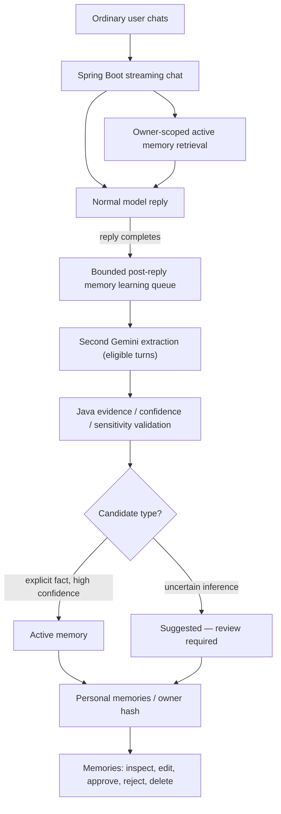

# M2 — Personal Memory: Milestone Contract & OpenCode Review

> **Milestone:** M2 · Persistent personal memory  
> **Repository:** `leeroy-chakanyuka/chomiii`  
> **Pull request:** [#3 — automatic memory and reviewable inferences](https://github.com/leeroy-chakanyuka/chomiii/pull/3)  
> **Branch:** `feat/m2-consented-personal-memory` (historical branch name)  
> **Status:** Implementation proposed; tests and production suitability must be independently verified before merge.  
> **Date:** 2026-11-05

## 1. What are we building?

**Chomiii is a general-purpose personal assistant for everyday people, not a coding agent.**

M2 makes Chomiii remember useful information **automatically** from ordinary conversations, and use those memories when relevant in future chats. People must be able to **see, correct, approve or reject suggested inferences, and delete** what the assistant knows. The person should **not** need to manually curate or opt in to every memory.

**M2 is not** full autonomous agent execution, calendar/email integration, cross-device accounts, a scheduling system, or a generic developer telemetry engine.

## 2. Why?

A personal assistant that forgets ongoing commitments and preferences forces people to repeat themselves. If someone naturally says "My usual groceries include oats and milk," Chomiii should be able to use that detail next time, without requiring a separate "save memory" command.

The outcome is **useful continuity without sacrificing visibility or correction**.

## 3. For whom?

Everyday people, including busy mobile-first users, not technical people who enjoy managing prompts, embeddings, model providers, or agent skills.

A person should simply chat. The Memories panel exists to **review and control what was learned**, not as a mandatory data-entry form. Labels and confidence indicators must be understandable without AI jargon.

## 4. What does success look like?

1. **Default-on learning:** Eligible, successfully completed user turns are considered for memory learning without any opt-in checkbox, local storage flag, or `X-Chomiii-Learn-Memory` header. Uninteresting/short turns may be skipped.
2. **Bounded cost and latency:** The optional-to-schedule extraction work runs after the visible response and never blocks first token. When it runs, it makes another provider request and consumes additional tokens. The UI must disclose this.
3. **Grounded learning:** Java validates at most two proposed memories, with an exact evidence fragment from the most recent user message, allowed type, confidence range, length and sensitive-content checks. The model never writes directly to the DB.
4. **Conservative inference:** Evidence-backed explicit facts can be active. Lower-confidence facts and interpretations are `suggested` and **not used for recall** until the person approves or edits them. Scores are model estimates, not calibrated accuracy.
5. **User control:** People can list, edit, approve, reject, delete, clear and manually add memories. Changes are owner-scoped. Manual edits and deletions invalidate older pending extraction jobs through a memory revision check.
6. **Relevant recall:** Only relevant **active** memories are returned for chat, at most three, using a small character budget. They appear as lower-trust `USER` context, not system instructions.
7. **Recall control:** The existing `Use saved memories` checkbox may suppress retrieval for an individual chat request. This is not a learning opt-in.
8. **Isolation:** A browser-session owner cannot read, correct, approve, delete or recall another owner's memories. Never accept an owner ID from the model as authorization.
9. **Honest limitations:** No account-based identity or cross-device memory yet. The current identity is an anonymous browser cookie. No retention cleanup, guaranteed deletion from provider logs/backups, or high-confidence semantic search has been proven.
10. **No phantom actions:** Memory never authorizes sending email, spending money, cancelling an appointment, or calling an integration. Those belong to M3/M4 with real approvals.

## 5. Proposed architecture



### Components to inspect in PR #3

- `backend/src/main/resources/db/migration/V3__personal_memories.sql` — memory table, source, status, confidence, origin, and owner revision.
- `backend/src/main/java/com/chomiii/memory/` — repository, memory service, retrieval selector, candidate parser, bounded extraction worker.
- `backend/src/main/java/com/chomiii/chat/ChatStreamService.java` — independent chat streaming, optional retrieval, **automatic** post-response extraction scheduling.
- `backend/src/main/java/com/chomiii/chat/ChatStreamController.java` — recall control, **no learning opt-in** header.
- `frontend/src/MemoryPanel.tsx` and `frontend/src/memoryApi.ts` — management and disclosure.
- `frontend/src/useChat.ts`, `frontend/src/chatApi.ts`, `frontend/src/App.tsx` — no learning toggle or learning flag; recall control remains.
- `docs/m2-research.md`, `docs/m2-design.md`, `docs/design/memory-contract.md` — rationale and constraints.

## 6. Expected everyday scenarios

**A — Direct preference:** User says, "My usual groceries are milk and oats." Chomiii replies normally. Afterward the extraction may create a grounded active memory, and a later conversation about usual groceries can recall it.

**B — Uncertain inference:** User says, "I went shopping early today; maybe mornings suit me." Chomiii must not confidently save "I always shop in the morning." Any modest inference is suggested for review, not immediately injected in later chats.

**C — Correction:** A user sees "I prefer oat milk," edits it to "I prefer lactose-free dairy milk," and later recall reflects the correction rather than the old memory. Pending extraction from before that edit cannot overwrite it.

**D — Deletion:** A user deletes a memory or clears the memory store while extraction is queued. Old in-flight results must not recreate the deleted entry. The user is told deletion of the memory record does **not** erase earlier chat messages, backups, or provider requests.

**E — Wrong owner:** A different browser session cannot access, correct, approve, or recall the other owner's facts even with a copied UUID.

**F — Sensitive information:** The extractor refuses prohibited/sensitive candidate types and secrets where detected, but do not claim a perfect privacy filter.

**G — No extra first-token delay:** Chat begins streaming before memory distillation; an unavailable, slow, or queue-saturated extractor cannot turn a successful reply into an error.

## 7. OpenCode: review and test plan

**Start with** `AGENTS.md`, `docs/prompt-brief-standard.md`, this document, `docs/m2-research.md`, `docs/m2-design.md`, `docs/testing.md`, and `docs/verification.md`. Read PR #3 and compare it with `main`. **Do not merge without explicit review and test evidence.**

### Backend unit tests (no live model required)

```bash
cd backend
./mvnw -Dtest=MemorySelectorTest,MemoryServiceTest,MemoryCandidateParserTest,MemoryLearningServiceTest,MemoryContextIntegrationTest,ChatIdentityTest test
./mvnw test
```

Verify normal chat succeeds **without** a learning opt-in; extraction runs only after successful completion; cancellation/failed turns do not trigger learning; output and queues are bounded; source and confidence are validated; and memory is not inserted into the system role.

### Database integration (use disposable DBs; do not run destructive tests on real user data)

```bash
# Set the repository's supported CHOMIII_DB_URL and credentials
cd backend
./mvnw -Dtest=MemoryDatabaseTest,ChatStreamDatabaseTest test
./mvnw verify
```

Run both **MySQL and PostgreSQL** configurations if both are supported. Verify Flyway V3 on each, owner foreign keys, `memory_revision`, all CRUD paths, suggested-to-active approval, deletion race, two owners, no cross-owner access, and no duplicate entries on repeated similar turns.

### Frontend tests

```bash
cd frontend
npm ci
npm run lint
npm run typecheck
npm run test
npm run build
```

Check `MemoryLearningDefault.test.ts` and `MemoryLearningReview.test.tsx`; ensure stale tests expecting opt-in have been removed. Manually inspect the Memories panel and chat composer.

### Manual end-to-end acceptance

1. Start backend + frontend against a disposable DB using the repo's documented setup.
2. With **no learning setup step**, send an everyday preference during a normal chat.
3. Check the response streams normally. Review Memories afterward for an active fact or suggested inference; document actual extraction success/failures.
4. Open a separate conversation and ask about the learned preference; check retrieval and response.
5. Edit, reject, approve and delete memories; repeat retrieval and verify results.
6. Turn **Use saved memories** off, check retrieval is suppressed, and verify automatic learning remains independent.
7. Retry with another browser/session; verify isolation.
8. Inspect logs for accidental API key or user-secret exposure; confirm no credentials are persisted as memories.
9. Measure p50/p95 first visible text and estimate **extra Gemini inference calls, tokens and cost** compared with no memory learning.
10. Record exact commands, exits, test counts, failures, and any model/provider variability in `docs/verification.md`.

### Before merging

- [ ] Compile, unit tests, and frontend checks pass.
- [ ] Both SQL migrations/databases are verified or a discrepancy is documented and fixed.
- [ ] Manual learn → recall → correct → delete journey works without any opt-in.
- [ ] Owner isolation and stale-extraction deletion tests pass.
- [ ] No remaining references requiring `X-Chomiii-Learn-Memory` or `Learn from chats` toggle.
- [ ] UI transparently explains automatic extraction and extra model usage.
- [ ] Review code for false inferences, secrets, prompt injection and unexpected retention.
- [ ] Any remaining account identity/retention work stays recorded in [Issue #4](https://github.com/leeroy-chakanyuka/chomiii/issues/4).
- [ ] Do **not** merge PR #5 (M3) before PR #3 and its migration are stabilized.
- [ ] Reviewer approves PR #3, then merges it; do not record "green" tests without actual output.

## 8. Non-goals and the next milestone

M2 is about **personal memory**, not task execution, JWT authentication, or a new agent personality. The current model-reported confidence is heuristic and not calibrated. Automatic learning can miss facts or make mistakes and must be evaluated with real everyday scenarios.

**M3's actual objective:** transform a compound natural-language request into a bounded plan of tool calls, obtain consent where required, execute via Java-controlled tools, observe results, and report accurate outcomes. A standalone task panel is not the target user experience; it can be replaced with in-chat proposals/approvals during the M3 redesign.

**Definition of M2 done:** Chomiii remembers useful non-sensitive details from ordinary chat by default, lets the user correct and delete them, recalls appropriate facts safely across browser-session conversations, and passes the stated verification gates.
