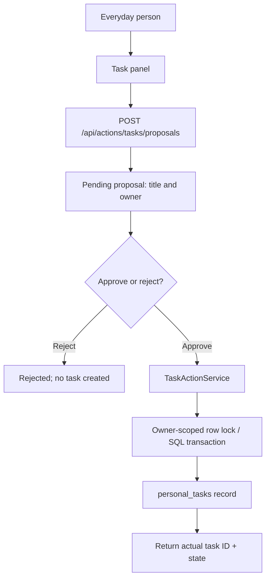

# M3 — First safe, authorized action

**Status:** an initial, stacked implementation PR based on M2; not merged or release-certified. This is an honest **first slice**, not a general tool-calling agent.

## The four product questions

**What?** Chomiii should be able to carry out a real, inspectable action in its own application—create a personal task—**only after the person authorizes that specific action**. The first vertical slice exposes a typed task proposal, explicit approval/rejection, an idempotently created task, and a completion state.

**Why?** A general-purpose personal assistant eventually has to *do* useful things rather than merely talk about them. Before email, calendars or purchases, we need reliable authority boundaries and a precise distinction between a suggestion and a completed side effect.

**For whom?** Ordinary people managing a busy day. A nontechnical person should be able to review what Chomiii is proposing, approve or reject it, and see whether it was actually done.

**Success criteria:** no task row exists before approval; approving exactly once creates one task; retrying returns the original task; foreign owners cannot approve, read, or complete; rejecting prevents execution; invalid input and cross-origin mutations fail; UI accurately distinguishes pending proposals from created tasks.

## Current architecture

- `TaskActionController` handles known, typed REST operations only. The browser session owner comes from the existing secure cookie filter, not from a request body or model text.
- `TaskActionService` is the application policy boundary. Its `approve` method locks the owned proposal and creates one task in the same database transaction, with the proposal ID uniquely identifying the resulting task.
- `TaskActionRepository` uses Flyway V4 tables for `task_proposals` and `personal_tasks`. There is no arbitrary shell, browser, email, shopping or notification tool.
- The Tasks panel allows the person to prepare, review, approve, reject, view and complete tasks. It intentionally requires explicit approval.
- Proposals are stored separately from completed results. A task marked *open* is not an email, calendar booking or scheduled notification.

## What's intentionally missing

This first slice is **not** a model-run tool loop. Chomiii cannot yet interpret "Please remind me tomorrow" and autonomously call a typed action through Gemini function-calling. It cannot send reminders at a future time. A separate, bounded model tool router is a next M3 step, where the model may propose a tool call but Java still enforces the approval boundary.

Future stages must add typed tool descriptors, function-call parsing, explicit proposal review in the conversation, controlled stop/resume, action audit receipts and safe retries. Consequential external operations must receive fresh scoped approval and real integrations in M4, never model-declared permission.

## Trust and concurrency decisions

- All mutations retain the M1 same-origin and browser-session protections.
- The authority to suggest an action does **not** imply authority to execute it.
- Only `POST /proposals/{id}/approve` executes the creation, after review. The model cannot invoke this endpoint.
- Approval locks the proposal row; an already approved proposal returns its existing task, not a duplicate.
- A rejected proposal cannot be approved later.
- Ownership is enforced at SQL query time, including approval, rejection, list and completion.
- Failure of a downstream database write rolls back both proposal state and task creation.
- The API never reports a task as created merely because a proposal exists.

## Verification debt

Run `TaskActionServiceTest` and `TaskActionDatabaseTest` against PostgreSQL and MySQL, then the complete Maven and frontend test suites. UI tests cover pending/approved/error states and API contracts. Existing GitHub Actions billing prevents runner allocation, and no unexecuted test is recorded as passed.

This PR is **stacked on M2** because its Flyway V4 migration follows M2's V3 migration. Retarget to `main` only after M2 merges and the database migration order is reconciled.

## Next M3 implementation slice

Bridge validated Gemini tool proposals into this **same backend policy** rather than giving model output database or HTTP authority. Model says "propose task" with constrained arguments; Java checks tool name, limits, owner and permissions; the person sees an approval request; server executes once only upon approval; the assistant reports an actual receipt. Add failure, cancellation, tool-call budget and prompt-injection tests before expanding tool access.
