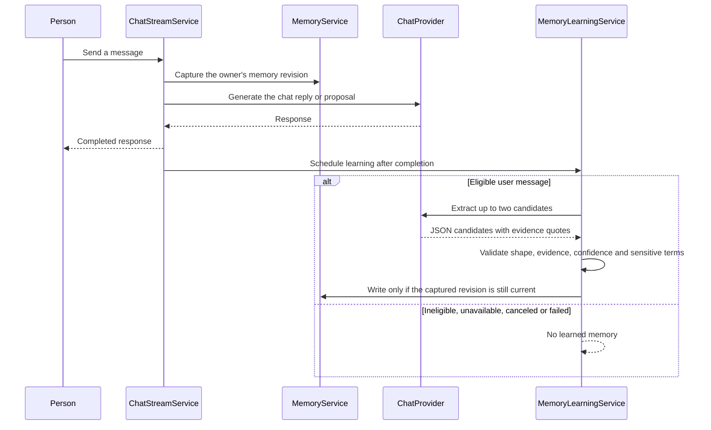
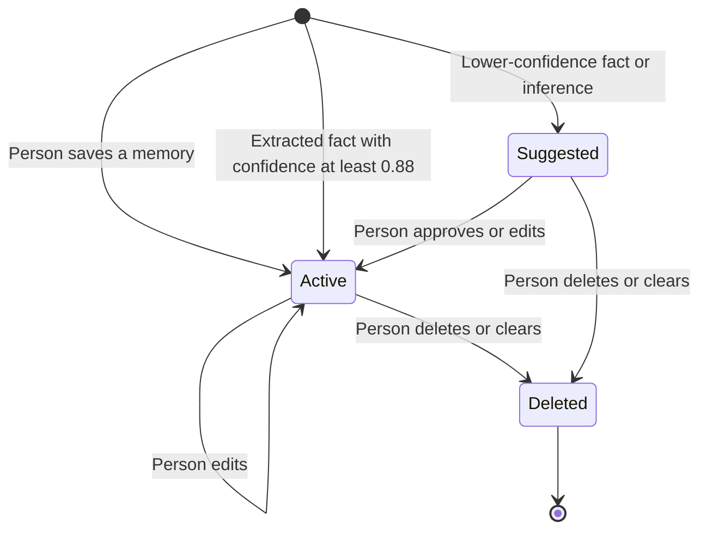
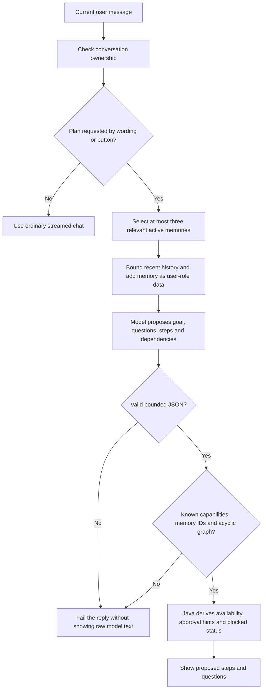
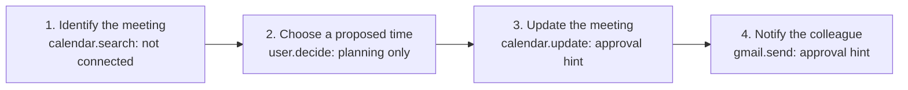
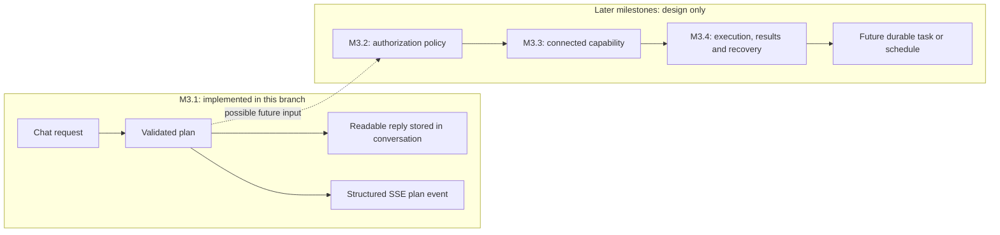

# How memory and planning work together

This guide follows a person's message through Chomiii's M2 memory and M3.1
planning code. The person might ask, "I'm working late. Help me rearrange my
meeting and tell my colleague."

Chomiii can propose steps in chat. It cannot create a persistent task, send a
message, change a calendar, or execute the proposed steps in M3.1. A plan is a
proposal, and an approval hint is not permission.

See the [product vision](product-vision.md), [context strategy](context.md),
[M2 design](m2-design.md), and [M3.1 design](m3.1-design.md) for the full
contracts and limits.

## The whole path

```mermaid
flowchart LR
    Person["Person writes a message"] --> Chat["Owner-scoped chat"]
    Chat --> Route{"Planning request?"}
    Route -->|No| Normal["Normal chat response"]
    Route -->|Yes| Select["Select relevant active memories"]
    Select --> Context["Recent history + request + untrusted memories"]
    Context --> Model["One planner call through ChatProvider"]
    Model --> Validate["Parse and validate proposal in Java"]
    Validate -->|Valid| Show["Structured plan event + readable chat reply"]
    Validate -->|Invalid or timed out| Fail["Show a failed response"]
    Normal --> Learn["Eligible completed turns may trigger memory extraction"]
    Show --> Learn
    Learn --> Store[("Owner-scoped memory store")]
    Store --> Select
```

The local router recognizes some planning language without another model call.
It can miss a request or route a question incorrectly. **Make a plan** in the
composer is an explicit fallback. Normal chat does not use a separate planning
classification call.

## How a memory is learned

Extraction considers the latest eligible user message, not the whole
conversation. Eligibility currently requires 25 to 2,000 characters and a
personal-language match. The parser checks that each evidence quote appears in
the message, but that literal match does not prove the inferred claim is true.
The model's confidence value is not a calibrated probability.

Learning is separate from recall. Turning off **Use saved memories** prevents
retrieval for that chat request. It does not turn off the existing automatic
post-reply learning step.

## Memory lifecycle and correction

Only active records enter planning context. An approved inference remains
identifiable by its source; approval does not prove that it is current. The
memory service scopes every read and mutation to the browser session owner.
Manual changes advance a revision, so a queued extraction from before a delete,
edit, or clear cannot restore the old result.

M2 does not automatically reconcile all contradictions. The live M2 sample
retained both an old bus commute and a newer cycling commute. The planner must
not assume both are current. It can ask the person which applies. Timestamps and
source labels are context, not an automatic rule that the newest record wins.

## How a planning decision is made

`MemorySelector` uses lexical matching. It can miss a useful paraphrase or
return a relevant but outdated record. The current query selects up to three
active memories within a 1,400-character selection budget. The model receives
their IDs, content, source, and timestamps in a lower-trust user-role message.
It cannot use a memory ID outside the selected set in a valid plan.

The model proposes the goal and step descriptions. Java owns the catalogue,
checks the dependency graph, orders prerequisites before dependent steps, and
derives whether a future capability is connected and whether approval would be
needed. The validator rejects unknown IDs, duplicate IDs, cycles, missing
references, unsupported fields, and over-limit output. It also rejects some
obvious claims that an external action already happened. It cannot prove the
meaning of arbitrary natural-language descriptions; semantic review remains
necessary.

## Example: a meeting conflict

Assume the person previously saved, "I prefer appointments after ten in the
morning." The person now asks to reschedule a meeting and notify a colleague.
The model may propose this dependency graph:

This graph says what would need to happen, not what happened. Calendar and
Gmail capabilities are catalogue descriptions marked `not_connected`. The
planner cannot check actual availability or send a notification. It should
ask about missing meeting details instead of inventing them. A future update
or send has an approval hint; M3.1 has no approval or connector implementation.

The live evaluation found that one valid meeting proposal omitted the update
and notification steps despite stating both goals. A later prompt revision
included them in one actual-M2 run, but another oracle run still omitted a
preparation step. These examples are observations, not measured accuracy rates.

## Proposed steps versus future tasks

The structured plan event exists during the stream. Reopening the conversation
shows the saved readable proposal; it does not restore a separate structured
task object. There is no task table, background scheduler, execution loop, or
approval state machine in this change.

## What remains uncertain

- The router is heuristic and needs broader false-positive and missed-request
  evaluation. The button provides a visible fallback.
- Memory retrieval is lexical. Suggested memories are excluded, and active
  records may be stale or contradictory.
- Model-written titles and explanations are not semantically proven by JSON
  validation. A simple completion-claim filter cannot cover every phrasing.
- The 30 planning scenarios and semantic scores need independent review. A
  successful structured response is not a quality pass.
- The live model sample is small. It does not establish goal accuracy, safety
  rates, or an improvement in ordinary-chat latency. See
  [M3.1 evaluation](m3.1-evaluation.md) and the saved reports.
