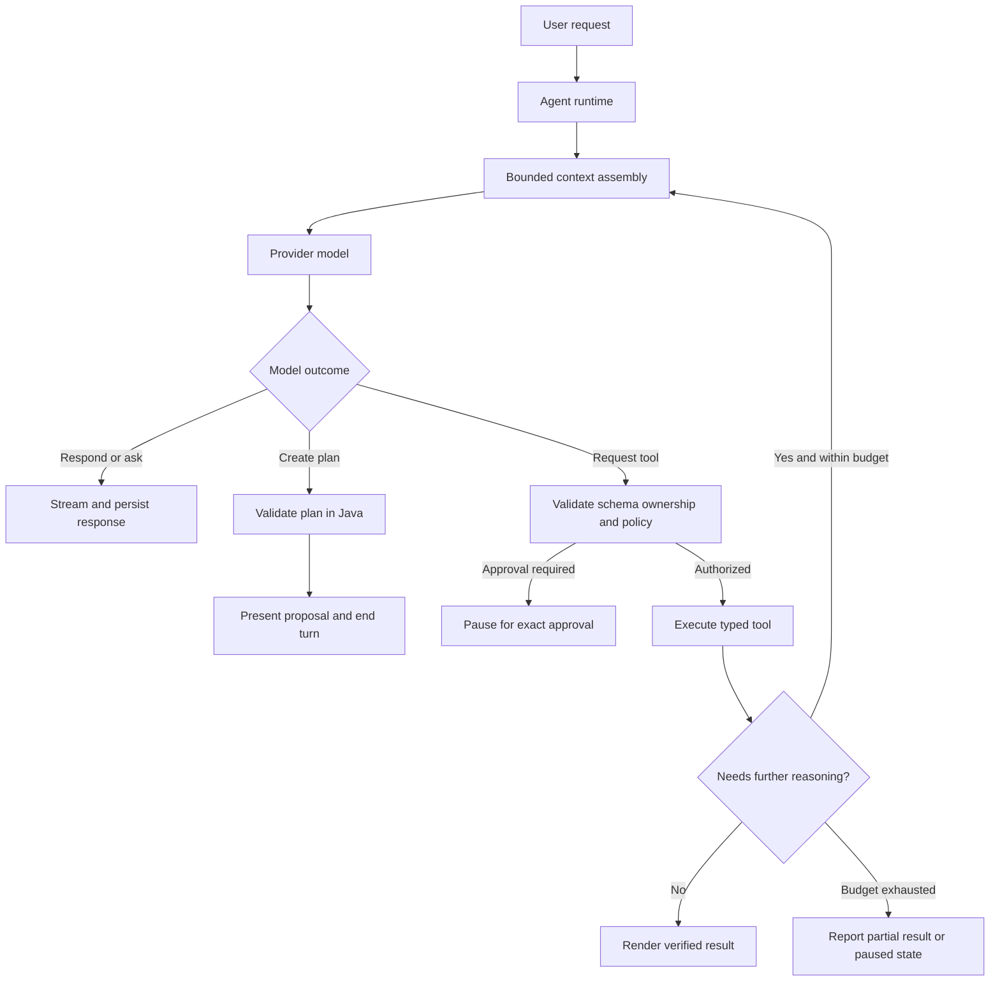

# Model-driven orchestration: planning without keyword routers

**Status:** Proposed architecture (not implemented)  
**Date:** 2026-11-25  
**Scope:** M3 agent runtime, planning, tool dispatch and inference efficiency

## Decision

Move toward one provider-neutral agent runtime that lets the model decide whether to respond, ask a question, propose a plan or request a tool. Java remains the authority over validation, authorization, state transitions and execution.

Do not optimize for nondeterminism everywhere. Optimize for semantic flexibility where human intent is ambiguous, and deterministic enforcement where correctness, privacy and side effects matter.

This proposal refines [target architecture](agent-architecture-plan.md) and the initial [M3.1 planning design](m3.1-design.md). It describes a migration, not an implementation or a claim that connectors already exist.

## 1. Problem with current routing

[PlanningRouter.java](../backend/src/main/java/com/chomiii/planning/PlanningRouter.java) uses four regex patterns: PLANNING, REQUEST, AMBIGUOUS and EXPLANATION. The current [ChatStreamService](../backend/src/main/java/com/chomiii/chat/ChatStreamService.java) selects planning using:

```java
boolean plan = request.plan() != null
        ? request.plan()
        : PlanningRouter.matches(request.content());
```

The router examines the latest message, not the meaning of the full conversation. An explicit composer override takes precedence. This was a deliberate early milestone optimization to avoid a separate classification call; it is not a complete intent classifier.

| Input | Desired behavior | Why keywords are insufficient |
| --- | --- | --- |
| Plan my week. | Propose a plan | Explicit vocabulary works |
| I have three deadlines and a family visit. Help me get everything done. | Plan or ask a necessary question | Planning implied |
| Do what we discussed yesterday. | Resolve context, then choose | Meaning resides in history |
| I already have a plan. | Respond appropriately | Keyword does not imply intent |
| Please explain the difference between a plan and a strategy. | Explain | Request words do not imply execution |
| Kan jy my week regkry? | Understand planning intent | Language and phrasing vary |
| Check my calendar. | Request a permitted read | A single action need not have a plan |

Adding more phrases, languages and domain-specific routers increases maintenance without solving semantic understanding. Users should not need to learn command vocabulary.

## 2. Alternatives and trade-offs

| Dimension | A: Regex router | B: Dedicated model classifier | C: Model-driven runtime (preferred) |
| --- | --- | --- | --- |
| Ordinary response | One generation | Classifier + generation | One generation |
| Intent context | Usually current text | Can include history | History, memory, available capabilities |
| Routing overhead | Negligible | Extra sequential inference | No separate classifier |
| Failure mode | Misses paraphrases, false matches | Misclassification, classifier/generator mismatch | Overplanning, incorrect or repeated tool requests |
| Implementation | Simple | Moderate | More complex runtime and adapters |
| Testing | Deterministic unit tests | Semantic evaluations plus tests | Semantic evaluations, runtime invariants and provider contract tests |
| Provider dependency | Low for routing | Classifier quality | Tool-calling and structured output reliability |
| Scalability of intent handling | Poor as domains expand | Better, but categories grow | Capability schemas and policy expand without keyword routers |

Option A remains a useful migration baseline. Option B is a possible fallback if a provider cannot support a reliable structured action protocol, but should not become a mandatory call on every message. Option C is the intended default, subject to evaluation. It trades simplicity for flexibility, and will not eliminate misinterpretation.

## 3. Proposed architecture



The model sees compact system instructions, relevant history, permitted memory and a bounded set of available tool definitions. It chooses the next action. The runtime owns the turn and decides whether a requested operation can proceed.

Conceptual outcomes, not a mandated Java wire format:

```java
enum AgentAction {
    RESPOND,
    ASK_USER,
    CREATE_PLAN,
    CALL_TOOL
}
```

Providers may represent these using native tool calls plus ordinary streamed text, or a validated structured envelope where native function calling is unavailable. Do not force every conversational answer into a large JSON object just to unify adapters. Preserve provider-specific message IDs, tool-result correlation and continuation metadata at the adapter boundary when required. Never infer a tool call from unvalidated prose. If an adapter cannot implement the contract reliably, disable unsupported capabilities or use an explicitly tested fallback.

### Planning as a terminal capability

Expose a typed internal capability such as `create_plan(goal, summary, constraints, questions, steps, memoryReferences)`. Reuse the existing plan contract, parser and catalogue rather than inventing a second schema. This is an internal proposal capability, not an external write or permission grant.

The model supplies the actual proposal in its initial tool call. Java validates the payload, derives trusted fields and renders the structured plan event plus readable response. No second model generation is necessary just to say that a plan was created. Preserve the existing readable response persistence behavior; durable structured plans require an explicit persistence design.

The explicit **Make a plan** composer control stays as a user preference/override. It should request a proposal, not bypass policy or imply permission to act. Define and test the semantics of an explicit false value versus an unspecified override during migration.

Suggested prompt guidance:

> Create a structured plan when a user's goal requires coordinating multiple dependent actions or commitments. Do not plan unnecessarily for straightforward questions or simple actions. Infer intent from the conversation as a whole. Ask only for information necessary to proceed; distinguish planning questions from execution questions. A proposed plan does not authorize execution. Never claim an external action succeeded without a verified result.

### Tool results and continuation

A read such as calendar lookup may require a second model call if the results must be interpreted. Independent reads can be requested together and their results returned in a batch. Dependent calls must respect ordering. Simple results may instead be rendered directly by Java/UI when the tool contract explicitly supports terminal output.

A consequential action pauses for approval when policy requires it. Approval is bound to the owner, exact tool, canonical arguments, target and relevant expiry/version. Changing arguments invalidates approval. An approved action still requires a fresh policy and availability check. A model's confidence or assertion cannot grant authority.

## 4. Deterministic boundary

| Model may propose | Java must enforce |
| --- | --- |
| Intent and next action | Owner scope, enabled capabilities and permissions |
| Plan steps and dependencies | Allowed capability IDs, graph validity, trusted availability and status |
| Tool and arguments | Typed schema, limits, canonical target and authorization |
| Memory relevance or candidates | Consent, provenance, revision checks and owner isolation |
| Whether to continue | Iteration, token, time, concurrency and cancellation limits |
| Explanation of results | Actual execution outcome, idempotency, audit and truthful status |

User content, retrieved memory and tool outputs are untrusted data, not system instructions. Do not expose secret credentials to the model. Tool results cannot introduce new permissions. The runtime must reject unknown tools, malformed calls, oversized payloads and unauthorized requests. Do not expose a general shell/browser as a shortcut to initial tool integration.

Preserve the existing PlanParser checks (bounded schema, unique IDs, valid memory references, known capabilities and acyclic dependencies). A valid schema is not proof of semantic correctness. Unavailable catalogue items may appear only as explicitly unavailable proposal steps, never as executable tools.

## 5. Free API key feasibility

Free-tier development is viable in principle, but not guaranteed for a particular model, account, region or usage pattern. Model access, quotas and function-calling support must be checked for the actual provider/project. For Gemini, check the [rate-limit documentation](https://ai.google.dev/gemini-api/docs/rate-limits), [function calling documentation](https://ai.google.dev/gemini-api/docs/function-calling) and actual project limits in AI Studio. No specific live allowance or pricing is asserted here.

Distinguish a user turn, an inference request and a tool invocation. Local tool execution is not itself a model request; a later interpretation of its result is. Retries and eligible post-turn memory extraction may add requests.

Illustrative generation counts (excluding memory learning and retries):

| User turn | Model requests |
| --- | ---: |
| Greeting or explanation | 1 |
| Clarifying question | 1 |
| Direct terminal plan | 1 |
| Read and summarize a calendar | 2 |
| Two independent reads with batched results | 2 |
| Multi-stage task with dependent operations | 3–5, subject to limits |

If a hypothetical project has 100 requests/day, one request per turn permits 100 turns, two permits 50, three permits 33 and five permits 20. This is arithmetic, not a claim about Gemini's current allowance. A 100-request budget also cannot guarantee throughput when input tokens/minute or requests/minute bind first.

Estimate total demand as:

```text
total requests = foreground generations
               + continuation generations
               + memory extraction
               + retries
```

Measure token usage across each request, not just new text; history and tool schemas may be resent on continuations. Shared project limits mean multiple users can exhaust a shared allowance. Do not rotate keys or projects to evade provider limits. A free key is appropriate for constrained personal testing, not a promise of production-scale capacity. Evaluate free-tier data handling before sending sensitive user information.

### Efficiency requirements

1. Terminal actions: no automatic follow-up generation for a valid plan, approval card or directly renderable verified result.
2. Parallel independent reads: batch results and preserve per-call correlation. Never parallelize conflicting writes merely for speed.
3. Bounded loops: begin with a configurable five foreground generations per user turn as an experimental default, not a proven optimum. Also cap tool calls, elapsed time, retries, context size and concurrent work. Count attempts against relevant budgets, including retries.
4. Selective context: retain recent relevant history, necessary tool results and authorized memory. Keep stable prompts compact. Expose only appropriate capabilities using permissions and context, not a new keyword intent gate. Preserve enough information for correct continuation; do not silently truncate tool results required for safety.
5. Quota-aware behavior: observe provider limits where available, distinguish throttling from permanent failures, use bounded retry/backoff and never replay a write blindly. When the budget is exhausted, report verified partial results and what remains. Resume only with persisted state and authorization where supported; otherwise explicitly state that the current run ended.
6. Measure post-turn memory learning separately. The existing pipeline can make another inference call. Investigate optional candidate extraction alongside main generation later, without weakening consent, evidence validation, reconciliation, revision checks or deletion guarantees. Do not require every chat answer to perform extraction, and do not silently remove existing memory functionality.

## 6. Migration plan

### Phase A: Define runtime and evaluation contract

- Capture current router baseline, tests and representative traces.
- Define provider-neutral response/tool-call events, normalized results, terminal outcomes and budget accounting.
- Specify SSE behavior for text, validated plans, tool progress, approval and failure. Retain cancellation and ownership guarantees.

### Phase B: Model-driven planning, no external writes

- Extend the existing ChatProvider boundary with structured action/tool support and contract tests for adapters.
- Introduce the runtime with ordinary streaming and terminal create_plan.
- Use authorized relevant memory in the unified context and pass the actual selected IDs to validation.
- Extract reusable plan validation/rendering from PlanningService as needed. Avoid a second planning generation when the first model produced the proposal.
- Keep the composer override and temporary feature flag/rollback path. Remove regex routing from the default path after evaluation, not before.
- Ensure invalid or mixed outputs fail safely; don't present malformed plans as successful.

### Phase C: One harmless read-only tool

- Implement an owner-scoped read through the typed registry and policy.
- Add continuation after a result, tool-call correlation, bounded loops and observable traces.
- Test cancellation, timeout, quota exhaustion and partial results.

### Phase D: Expand only after the safety boundary is proven

- Add approval-bound writes and idempotency before consequential integrations.
- Add durable task state and resumption deliberately; never treat a saved chat message as proof an action executed.
- Reconcile milestone sequencing with current M3 work before merging implementation changes. This document does not renumber milestones or implement them.

## 7. Evaluation and acceptance

Use a versioned dataset with expected *behavior*, not exact wording. Include several valid outcomes when ambiguity warrants clarification.

| Scenario | Expected behavior |
| --- | --- |
| Direct simple question | Answer, no plan or tool |
| Explicit planning request | Valid proposal |
| Implicit multi-step request | Plan or necessary clarification |
| Contextual follow-up | Use history; no invented prior details |
| Explanation containing planning keywords | Answer, no plan |
| Single read request | Authorized tool or truthful unavailable response |
| Multiple independent reads | Batch where supported |
| Explicit plan override | Honor within policy |
| Malformed/unknown tool call | Reject without execution |
| Tool-output prompt injection | No privilege change |
| Cross-owner memory/tool reference | Reject |
| Write without valid approval | No side effect |
| Repeated call or interrupted write | No duplicate side effect |
| Rate limit or loop cap | Bounded failure/partial progress |
| Cancellation | Stop further work, accurately report completed effects |

Run the same semantic scenarios across supported models, including the actual free-tier model. Repeat stochastic cases and vary paraphrases, language, negation and multi-turn context. Track false-positive planning, missed planning, wrong tool choice, unnecessary clarification, schema validation failure, task completion, requests/turn, tokens/turn, time to first visible output and completion latency. Separate foreground and memory-learning metrics.

Initial engineering acceptance targets (proposed, not measured): one foreground call for ordinary chat and terminal valid plans; no unauthorized or duplicate side effects in adversarial integration tests; bounded execution on every path; demonstrably improved semantic routing against the regex baseline with acceptable latency and quota use. Agree numerical semantic accuracy thresholds after measuring the baseline. No model evaluation substitutes for deterministic authorization tests.

## 8. Observability and open decisions

Record turn ID, provider/model, iteration, action category, duration, token usage when reported, tool outcome, approval state and stop reason. Use existing tracing infrastructure where suitable. Redact secrets and sensitive arguments; enforce owner-scoped access and retention. Do not log hidden reasoning or require a model to expose it.

Open questions: Which provider adapters reliably support the protocol? How should streaming text mixed with tool calls be committed? What are actual free-tier limits and measured call distributions? Which plans require durable structured state? How should the current override contract evolve? Resolve these with small implementation slices and evidence.

**Guiding principle:** the model interprets what the person wants and proposes how to help; the backend determines what is valid, authorized, executable and verifiably complete.
