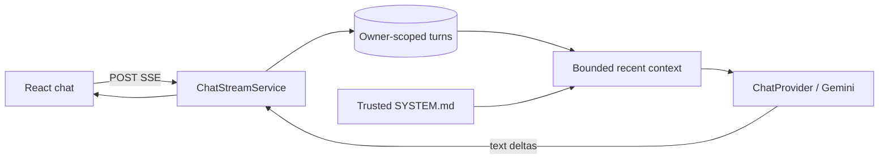
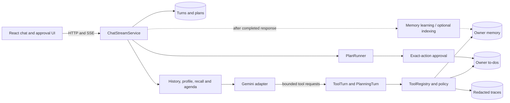
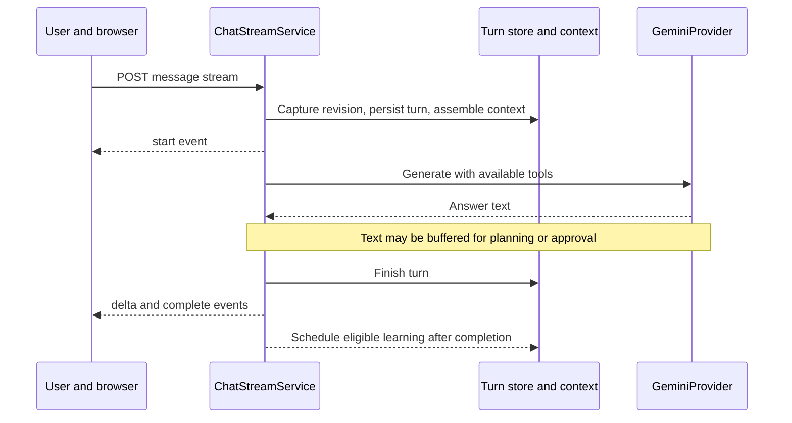
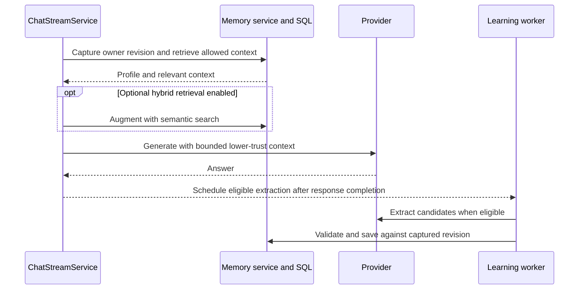
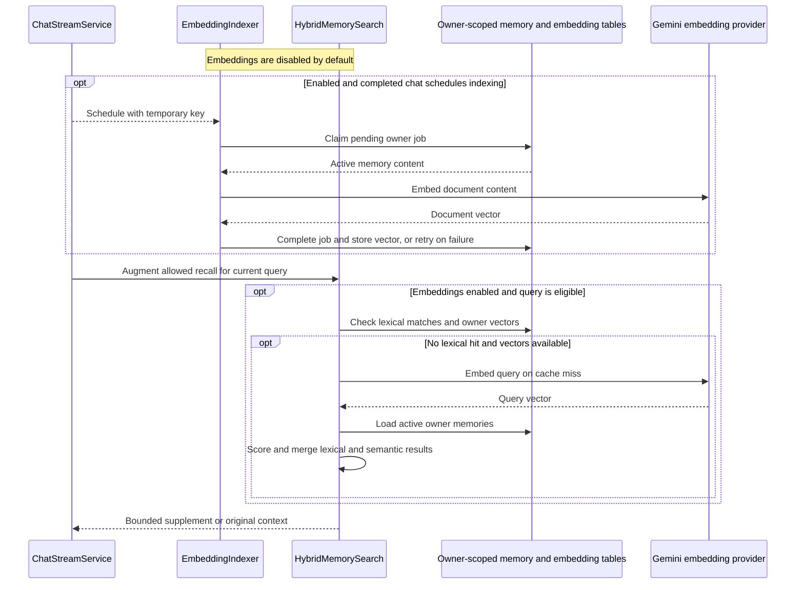
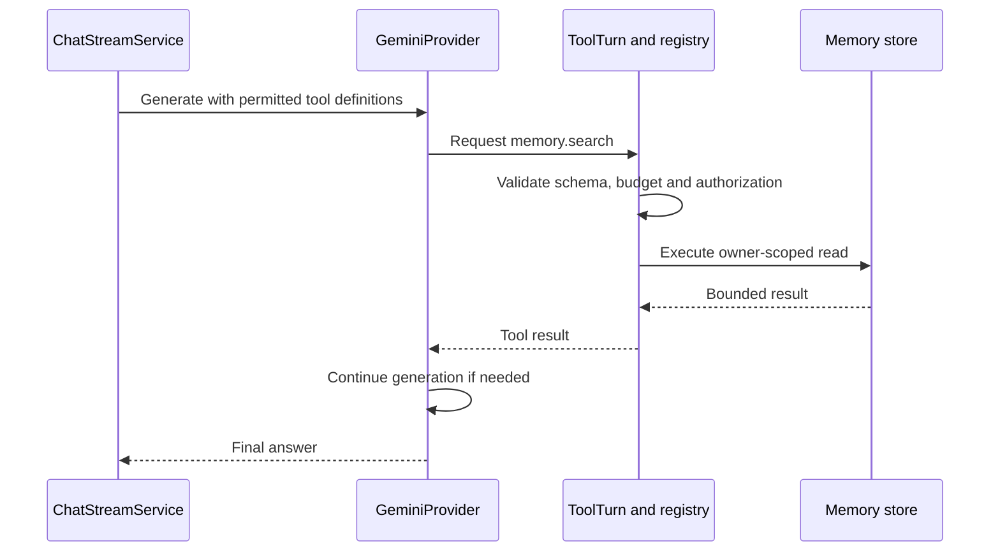
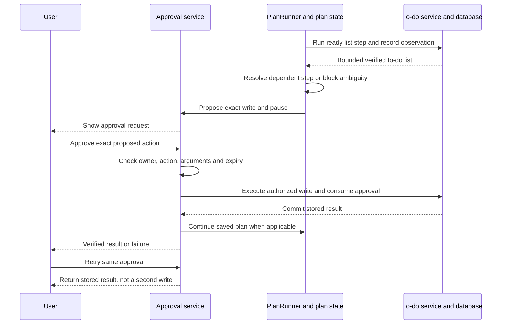

# M1 to M3 engineering performance retrospective

This retrospective describes merged main at `7b72dd2`, including PR #12 and PR #14, and summarizes historical and current exploratory measurements. It uses fictional examples only. It does not claim a speedup.

## Executive summary

Chomiii grew from a persisted streaming chat into an assistant that can recall owner-scoped memory, propose plans, and execute approved local to-do actions. Each capability adds useful work and additional opportunities for latency: context reads, model tool continuations, validation, durable state, and approval waits. The product goal is useful help for everyday people, not the shortest possible agent trace. See the [product vision](../product-vision.md).

The M1.1 five-sample browser run recorded **15.14 seconds median** to first visible text, with a 17.43-second nearest-rank p95. The requested two-second target was not met in that run. Direct Gemini generation was also slow and variable. The measured M1.1 provider wait is not proof of the bottleneck on M3.

The current source contains a particularly important question for a new baseline. With the injected `PlanRunner`, ordinary turns select internal planning and buffer text for approval. The provider can also buffer text when tools request it. This protects against presenting an unvalidated or misleading response, but can postpone visible text until generation and subsequent work finish. Source inspection establishes the behavior, not its observed latency or its size relative to provider time.

The [M3 current benchmark](m3-current-benchmark.md) recorded a **2.08-second median** and 2.38-second p95 for three successful browser measurements. One of three measured app API requests timed out after 90 seconds. High CPU load, tiny samples, different instructions and context, and the absence of a contemporaneous old-version control make the comparison inconclusive. The two browser medians do not establish a speedup.

## Timeline and evidence

| Milestone | Git and PR evidence | Performance or architectural consequence |
| --- | --- | --- |
| M1 | `6aee99c`, `db9a9ab` | Request-scoped Gemini adapter, saved conversation turns, and POST SSE. A database transaction precedes generation for ownership and turn recovery. |
| M1.1 | `267e8f0`; [PR #1](https://github.com/leeroy-chakanyuka/chomiii/pull/1), merge `72fe099` | Stage timings and browser measurements exposed a long upstream wait. Removing a blocking conversation-list request eliminated a dependency, not a proven end-to-end speedup. |
| M1.5 | [PR #2](https://github.com/leeroy-chakanyuka/chomiii/pull/2), merge `4dfdf67` | A compact trusted identity and bounded recent history establish a context contract. Independent frontend refreshes run concurrently after a stream. The PR reported isolated Java checks, not a full-suite pass. |
| M2 | [PR #3](https://github.com/leeroy-chakanyuka/chomiii/pull/3), merge `2193e16`; [PR #6](https://github.com/leeroy-chakanyuka/chomiii/pull/6), merge `e6dee43` | Owner-scoped memory adds retrieval and post-turn learning. PR #6 integrated first-token work without reverting memory. |
| Evaluation | [PR #7](https://github.com/leeroy-chakanyuka/chomiii/pull/7), merge `58f59ee` | Synthetic memory cases and budgeted live evaluation separate pipeline tests from model accuracy. The PR records verification limits for its expanded corpus. |
| M3.1 | [PR #8](https://github.com/leeroy-chakanyuka/chomiii/pull/8), merge `fe09e80` | A typed, validated plan proposal adds planning context and validation. At that stage the proposal did not execute actions. |
| Proposal | `0c6eef8`, [model-driven orchestration](../model-driven-orchestration.md) | A proposal for semantic routing and inference budgets, not a delivered performance result. Its description of the old regex router and future phases is not the authoritative description of merged M3 code. |
| Memory foundation | [PR #12](https://github.com/leeroy-chakanyuka/chomiii/pull/12), merge `f03310d` | Persistent profiles, native memory search, optional embeddings, and owner-scoped tools add retrieval choices. Embeddings are disabled by default. The PR warns that some reported earlier test results predate later consolidation. |
| M3.3 and M3.4 | [PR #14](https://github.com/leeroy-chakanyuka/chomiii/pull/14), merge `7b72dd2` | Local to-dos, exact-action approval, durable plan progress, bounded execution, and private traces add safety and database work. A later [PR verification comment](https://github.com/leeroy-chakanyuka/chomiii/pull/14#issuecomment-7185586443) reports an isolated browser flow with fictional memories and fresh PostgreSQL. It is a functional check, not the performance benchmark. |

PR #12 merged into main as `f03310d`; PR #14 followed as `7b72dd2` on 2026-11-26. The [roadmap](../roadmap.md) mixes historical status with planned phases. Its references to open PR #12 and a review branch predate these merges. M4 connectors, persistent grants, scheduled background work, and general durable autonomy remain planned; merged M3 supports local to-dos, not email or calendar execution. The proposal in `model-driven-orchestration.md` is also a design document: parts of its migration narrative predate the merged `PlanningTurn` and tool runtime. Resolve implementation questions against source and tests.

## Architecture and critical paths

### M1.5 historical shape



The historical [context contract](../context.md) distinguishes the trusted system resource, user messages, and recent complete turns. Its statements about current memory and planning status describe an earlier milestone. It specifies a character budget, not a provider token budget.

### M3 merged shape



The diagram is a dependency view, not a promise that each turn uses every component. Memory and tool results are lower-trust data. Java owns schema validation, authorization, execution, and state. The model can request a tool; it cannot grant itself permission. See [tool foundation](../m3.2-tool-foundation.md) and [memory evaluation](../memory-evaluation.md).

### Path 1: ordinary conversation



The browser's `useChat.ts` appends `delta` events to visible state. After the stream, it refreshes the conversation and conversation list concurrently. The following is a direct excerpt from [`useChat.ts`](../../frontend/src/useChat.ts):

```ts
if (event.kind === 'delta') setStreamed((previous) => previous + event.text)
```

```ts
const [loaded, refreshed] = await Promise.all([openConversation(conversationId), conversations()])
```

This concurrency concerns post-stream refresh; it does not make the provider produce its first text sooner. [`chatApi.ts`](../../frontend/src/chatApi.ts) sends the POST and reads SSE events. For a new conversation, the creation request is a separate user-visible cost.

### Path 2: personal-memory retrieval and learning



Recall and learning have different controls and costs. Recall can be disabled for a turn; that does not by itself disable post-turn learning. Search can also be model-invoked, as described below. The provider sees selected memory, so data minimization and quality matter as well as retrieval time. Revisions prevent stale queued learning from undoing later user changes. See [`ChatStreamService.start` and `run`](../../backend/src/main/java/com/chomiii/chat/ChatStreamService.java) and [`MemoryLearningService`](../../backend/src/main/java/com/chomiii/memory/MemoryLearningService.java).

### Path 3: embedding indexing and hybrid retrieval



[`EmbeddingIndexer`](../../backend/src/main/java/com/chomiii/memory/embedding/EmbeddingIndexer.java) drains durable owner-scoped jobs after a completed chat when enabled and a key is available. Jobs do not store credentials. The document content is sent to the embedding provider; the resulting vector is stored in SQL. Indexing is background work and can add provider requests and cost even though it does not wait on the visible answer. Failed jobs are retried later.

[`HybridMemorySearch.augment`](../../backend/src/main/java/com/chomiii/memory/HybridMemorySearch.java) is on the context-assembly path. For ordinary proactive augmentation, it tries semantic search only for short explicitly personal queries with no lexical hit. It also needs an available key and stored vectors. On a cache miss it sends the query to the provider, waits up to one second for the query embedding, and falls back to the original or lexical context on failure. A two-minute owner-scoped cache can avoid a repeated query request. Explicit tool searches use `search` and have different entry conditions from proactive `augment`.

When embeddings are disabled, the indexer does not schedule work and search uses lexical results without an embedding call. Neither the historical synthetic ablation nor the current arithmetic benchmark measures live embedding retrieval latency or proves an answer-quality improvement. The [memory evaluation](../memory-evaluation.md) documents fake embeddings, scripted calls, and the changed profile policy.

### Path 4: model-requested read and continuation



This path can require more than one generation. A local read is not itself a model request, but interpreting its result can require another one. [`GeminiProvider.stream`](../../backend/src/main/java/com/chomiii/provider/gemini/GeminiProvider.java) currently bounds rounds and calls. It preserves function-response correlation when an ID is provided. A successful terminal tool can end generation without a further model response. The design's illustrative future five-generation budget is not the current adapter limit.

### Path 5: model-generated plan with `plan.stage`

```mermaid
sequenceDiagram
    participant U as User
    participant C as ChatStreamService
    participant G as GeminiProvider
    participant T as PlanningTurn and PlanParser
    participant P as Plan and turn store
    participant R as PlanRunner
    U->>C: Request help organizing work
    C->>G: Generate with plan.stage available
    G->>T: Call plan.stage with proposed to-do steps
    T->>T: Validate schema, budget, capabilities and plan
    alt Valid staged plan
        T-->>G: Staged, not saved or executed
        G-->>C: End generation without another model reply
        C->>P: Persist reply and plan
        C->>R: Advance supported ready steps
        R-->>C: Completed, blocked, or awaiting approval
        C-->>U: Plan progress and any approval
    else Valid plan requires clarification
        T-->>G: Staged; no steps executed
        G-->>C: End generation
        C-->>U: Ask for clarification without starting steps
    else Invalid proposal
        T-->>G: Validation error as tool result
        G->>G: May continue or recover within the tool budget
        G-->>C: Result of continuation or failed planning outcome
        Note over C: An unresolved planning failure can use the fallback
        C-->>U: Result or fallback without executing invalid steps
    end
```

[`PlanningTurn`](../../backend/src/main/java/com/chomiii/planning/PlanningTurn.java) exposes `plan.stage` for supported to-do capabilities. It validates the tool arguments and builds a plan with server-supplied step IDs and dependencies. A successful tool call stages the plan in memory and ends the provider generation; it neither saves nor executes the plan itself. `ChatStreamService.run` then saves it and may invoke the runner before sending the buffered response. If clarification is needed, the service does not start the steps. An explicit plan request uses a distinct path. A valid plan is structurally valid, not necessarily semantically useful.

### Path 6: multi-step tool execution and approval



[`PlanRunner`](../../backend/src/main/java/com/chomiii/planning/execution/PlanRunner.java) advances a bounded segment with per-step transactions. A dependent completion blocks if its list observation is truncated or does not identify exactly one open match. The approval wait is human time, not inference latency. Measure it separately from the execution transaction. The write and approval consumption commit together; replay returns the stored result. This is local-action idempotency, not a claim that arbitrary external operations run exactly once. See [`ApprovalService`](../../backend/src/main/java/com/chomiii/approval/ApprovalService.java), [`TodoService`](../../backend/src/main/java/com/chomiii/todo/TodoService.java), and the PR #14 description.

## What the source says about latency

At `7b72dd2`, [`ChatStreamService.run`](../../backend/src/main/java/com/chomiii/chat/ChatStreamService.java) contains the following condition. The injected production constructor takes a `PlanRunner`; tests can use other constructors.

```java
boolean internalPlanning = !planning && planRunner != null;
boolean bufferForApproval = planning || internalPlanning || approvals != null && toolRegistry.available(toolContext).stream()
        .anyMatch(definition -> definition.effect() == com.chomiii.tools.ToolDefinition.Effect.WRITE);
```

The delta consumer appends text to a buffer and sends a `delta` immediately only when `bufferForApproval` is false. In the buffered path, the service sends text after saving the response and any immediate plan progress. Separately, `GeminiProvider` can buffer its own text until a final tool outcome. Thus provider first text, first service delta, and first browser paint are different events. A `start` or tool-progress event is feedback, not answer text. Measure these boundaries before changing the buffering rule, and preserve the rule that an unapproved or failed write must not be represented as completed.

The service logs `store_ms`, `context_ms`, `queue_ms`, `first_delta_ms`, `first_sse_ms`, `finish_ms`, and `total_ms` without chat contents. `first_sse_ms` is the interval from the service's first delta callback to its first SSE send, not submit-to-paint. With provider-side buffering, the provider's own first-text timestamp can precede that callback. The Gemini log separates client initialization, request opening, first text, and total time. See the source before aggregating fields: boundaries and sentinel values matter.

## Measurements and what they prove

### M1.1 live measurements

The full method and raw files are in [chat latency measurements](README.md). The run used Windows, Java 21, Node 22, two logical CPUs, local PostgreSQL 17, `gemini-3.5-flash-lite`, a short arithmetic prompt, alternating direct and app calls, and one warmup per side.

| Run | Samples per side | App first text p50 / p95 | Direct first text p50 / p95 |
| --- | ---: | ---: | ---: |
| [Before](baseline.json) | 10 | 5.66 / 35.61 s | 7.11 / 12.93 s |
| [After](after.json) | 5 | 13.67 / 21.94 s | 18.88 / 21.63 s |

Five [Chromium after samples](browser-after.json) measured 15.14 s p50 and 17.43 s p95 from submit to painted text. App API timing starts at the stream POST and reports conversation creation separately. Some single-chunk completions preceded the next paint. With five samples, nearest-rank p95 is the maximum, not a stable tail estimate. The before and after runs occurred at different times and used slightly different system instructions. They do not demonstrate a speedup or regression.

In the five measured after API calls, [stage logs](stages-after.txt) report Gemini stream opening of 7.91 to 21.83 seconds, initial transaction 9 to 28 ms, context construction rounded to 0 ms, queue 1 to 15 ms, and first SSE send 1 to 8 ms. A [model-list probe](network.json) had a 0.60-second median across five calls. It shows a small authenticated request was faster during that window; it does not separate network, provider queueing, and inference. These numbers describe that machine and workload, not current M3 or all deployments.

### Current M3 exploratory measurement

The [benchmark report](m3-current-benchmark.md) and [sanitized samples](m3-current-benchmark.json) describe a run on 2026-11-26 at `7b72dd2`. It used `gemini-3.5-flash-lite`, a fresh local database and a short arithmetic request with no previous conversation or saved memories. The browser ran first, followed by alternating app API and direct requests. Each path had one warmup and three measured attempts.

| Path | First text or visible text samples | Nearest-rank p50 | Nearest-rank p95 | Measured failures |
| --- | --- | ---: | ---: | --- |
| Browser, first visible | 1.584, 2.376, 2.081 s | 2.081 s | 2.376 s | 0 of 3 |
| App API, first text | 1.895, 9.795 s | 1.895 s | 9.795 s | 1 of 3 timed out after 90 s |
| Direct provider, first text | 5.720, 1.363, 2.830 s | 2.830 s | 5.720 s | 0 of 3 |

The API percentiles exclude the timeout and use only two successful requests. The nearest-rank p50 is the lower of those two values, not their conventional arithmetic median. These percentiles are not reliable estimates. For three samples, nearest-rank p95 is the maximum. Browser timing begins before the automated Send click and ends after non-empty assistant Markdown is observed and two animation frames elapse. The complete event can precede that paint-related measurement. App API timing starts at the stream POST and excludes conversation creation. The direct request uses a different system instruction from M3, so it cannot isolate app overhead.

For the three browser calls, provider stream opening took 1,388 to 2,177 ms; initial store took 10 to 20 ms, context construction 6 to 24 ms, queue 1 to 5 ms, and final store 2 to 4 ms. Provider opening includes network, queueing and inference; no probe isolated the cause. Some reported intervals overlap, so do not sum them. CPU snapshots before the run were 93%, 99% and 100%; load was not controlled or continuously recorded. The app used development servers, and no live old-version control was measured. The arithmetic request did not exercise planning, actions, or eligible memory extraction. No token usage or provider billing was captured. These observations do not establish a speedup, a stable tail latency, or a general M3 bottleneck.

### Later evaluation evidence

The [memory retrieval ablation](../memory-evaluation.md) used 28 synthetic cases, five repetitions, fake embeddings, scripted tool decisions, and a disposable PostgreSQL database. Profile plus lexical retrieval reported 4.2 / 16.6 ms p50 / p95. The embeddings-plus-scripted-tool arm reported 15.7 / 60.5 ms. The machine was CPU-saturated, repeated observations were not independent cases, and current profile selection differs from the tested policy. These results do not establish real embedding quality, answer quality, or a production bottleneck.

The [M3.1 planning evaluation](../m3.1-evaluation.md) reports four final-run plans with provider-stream durations of 1,913 to 7,801 ms, context assembly of 0 to 66 ms, and validation of 1 to 75 ms. The run used pacing and a dirty working tree. It was too small for a useful p95, and plans were not independently graded for semantic quality. Structural validation is not evidence of task success. Neither evaluation is a matched M1-to-M3 comparison.

## Tradeoffs and bottleneck hypotheses

| Choice | Benefit | Cost or unanswered question |
| --- | --- | --- |
| Persist the turn before generation | Ownership, deduplication, and interrupted-turn recovery | A database transaction remains on the critical path. Historical milliseconds do not establish the cost under current concurrency. |
| Keep bounded context and profiles | Limits input and carries useful personal information | Selection can omit needed facts or include irrelevant ones. Character counts do not directly measure tokens, privacy impact, or answer quality. |
| Optional embeddings and tool search | Can retrieve beyond initial lexical selection | Embeddings and continuation can add latency, calls, and cost. The existing fake-embedding ablation does not prove a quality benefit. |
| Buffer potentially actionable text | Avoids showing unvalidated plans or premature success claims | First visible answer may wait for full model output, persistence, or plan advancement. The exploratory run does not isolate the effect of buffering. |
| Approval and checkpointed execution | Limits unauthorized and duplicate writes and supports recovery | More database work and user waiting. Optimizing the latter away would change the safety contract. |
| Request-scoped provider client | Limits credential and lifecycle coupling | Setup and connection reuse merit measurement. The historical SDK closes its client and pool, so pooling is not a free, proven optimization. |

The proposal in [model-driven orchestration](../model-driven-orchestration.md) argues against a mandatory classifier call and for semantic model decisions with deterministic enforcement. That is a testable design direction, not evidence that a classifier was removed by this proposal or that the current runtime meets its proposed targets. More model rounds can improve a result or waste time and quota; count them instead of inferring efficiency from the design.

## Regression prevention and reproduction

1. Extend the exploratory [M3 benchmark](m3-current-benchmark.md) with a representative, commit-identified baseline before setting thresholds. Record machine load, database, model, settings, prompt and context size, warmup, sample order, failures, and raw sanitized results.
2. Time submit-to-feedback, submit-to-painted answer, stream POST to first SSE text, provider first text, completion, and post-stream refresh separately. Measure conversation creation separately. Include successful and failed requests, not only fast successes. Record human approval wait separately from execution.
3. Compare matched configurations with alternating or randomized order and repeated runs. Hold model, instructions, tool schemas, context, history, memory state, workload, and environment constant where possible. Report sample counts and ranges; avoid treating a small-sample p95 as an SLA. A direct provider request is only a useful control when its actual request matches the application's.
4. Cover ordinary chat, recall enabled and disabled, long history, explicit and model-staged plans, read-and-continuation, approval, retry, cancellation, and failure. Measure foreground generation count, tool invocations, background extraction, token usage where available, and cost only when prices and actual usage are known. Test both database engines where storage behavior matters.
5. Pair latency with observable correctness: independently review whether answers use the right memory, whether plans meet the user's goal, and whether action receipts reflect verified effects. Use fictional fixtures and test owner isolation, permission denial, stale revisions, duplicate writes, and cancellation. A faster but unsafe or incorrect result is not a successful optimization.
6. Add focused tests for streaming and buffering semantics, including the distinction between progress and actual answer text. Preserve tests for parallel independent refresh, turn idempotency, approval binding, and bounded loops. Use privacy-safe timing logs and owner-scoped redacted traces, without keys, private prompts, or hidden reasoning.

The existing `tools/bench/ttft.mjs` alternates direct and app calls, checks the answer, and supports sample count, model, API origin, and output configuration. Its fixed direct system instruction describes an older no-tools, no-memory assistant; it does **not** automatically match merged M3's prompt, tool definitions, or context. `tools/bench/network.mjs` probes a small model-list request. `tools/bench/run-local.mjs` starts a disposable local stack and browser benchmark, but overwrites the historical `after.json`, `browser-after.json`, and `stages-after.txt` in its checkout. Use an isolated copy or explicitly preserve those artifacts. Live calls require an authorized environment key and may incur charges. See [benchmark setup](README.md).

The retrieval-only ablation can be reproduced without a provider key using the disposable-database instructions in [memory evaluation](../memory-evaluation.md). It is useful for repeatable local retrieval checks, not a substitute for a live, independently graded study. The current benchmark used a temporary runner; the [portable runner](../../tools/bench/m3-retrospective.mjs) reproduces its procedure without overwriting the historical artifacts.

## Transferable lessons and remaining gaps

- Optimize the dependency that blocks the user, not the number of lines or model calls alone. PR #1 removed a real blocking request, but noisy generation timings did not prove a measurable overall gain.
- Give every timing a start and end event. Streaming protocol completion, first provider text, first SSE text, and painted text answer different questions.
- Make safety costs visible rather than deleting safety checks. A transaction, validation, or approval can be essential even if it lies on the critical path.
- Separate structural validity, synthetic retrieval, and user outcome quality. Each answers a different question; none proves the others.
- Preserve provenance and version the tested source. A dirty tree, changed prompt, different context policy, or mixed provider configuration can invalidate a comparison.

Representative M3 first-visible latency, throughput under load, provider-call distribution, token cost, semantic routing quality, and privacy impact of proactive profile injection remain unverified. The three-sample exploratory measurement does not establish those values. Historical CI and local verification claims have their own scope in [verification](../verification.md) and the linked PRs. Future external connectors and restart-safe scheduled work require their own evidence, not extrapolation from local to-do execution.
