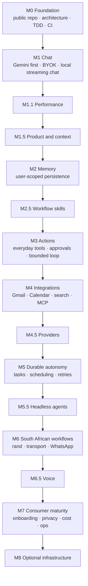

# Roadmap

Status of each milestone is checked against [verification.md](verification.md).
M0 established the foundation. M1 has a locally verified Gemini chat path;
its Docker startup remains unverified on the machine used for this milestone.
M1.1 has measured the latency bottleneck without meeting its speed target;
M1.5 product/context scope is delivered in PR #2, with full-suite verification still outstanding; see [M1.5 closure](m1.5-closure.md).
M2 memory is under active development in review PR #3; M2.5 (workflow skills) and M3 (authorized actions) remain planned;
real autonomous action is not currently implemented.

## M0 — Foundation

Prove the engineering discipline on a minimal vertical slice before any AI work: a **public repository**, a **two-process architecture** behind an explicit HTTP contract, **test-first development**, and **CI**.

**Implemented so far:** repository contract ([AGENTS.md](../AGENTS.md)), two-process architecture (Java 21 / Spring MVC backend, React + Vite frontend), dual-database configuration — MySQL locally via `application-local.yml`, PostgreSQL in CI/production via `application-prod.yml` — with Flyway versioned migrations, the `GET /api/health` contract with the RFC 7807 error convention, this documentation set, and the CI workflow definition in `.github/workflows/ci.yml`.

**Acceptance criteria — status as observed (see [verification.md](verification.md) for evidence; pending rows are M0's remaining work):**

| # | Criterion | Status |
| --- | --- | --- |
| M0-1 | Architecture proves test-first: backend unit/MVC tests green | ✅ Observed (23 tests after the database-strategy changes) |
| M0-2 | TDD red→green cycle demonstrably executed for the health endpoint | ✅ Observed (red 404, then green) |
| M0-3 | Frontend unit tests, lint, typecheck, build green; standalone Playwright suite green | ✅ Observed (7/7, lint/typecheck/build passed; 4 browser tests) |
| M0-4 | Database verification on both engines (local MySQL suite; PostgreSQL in CI) | ✅ MySQL suite and PostgreSQL migration smoke test passed locally; 🔶 PostgreSQL Testcontainers CI blocked |
| M0-5 | Frontend↔backend browser integration green | ✅ Browser-to-backend tests passed locally against both MySQL and PostgreSQL; CI blocked |
| M0-6 | Dependency audits (frontend high gate; backend OWASP scan in CI) | ⚠️ Frontend high threshold met; 12 moderate minimatch findings remain. Backend scan configured in CI, not yet executed |
| M0-7 | Public hosted repository, pushed history, and **CI green on it** | 🔶 Public repository created and pushed; GitHub Actions blocked by an account billing issue |

## M1 — Chat (implemented locally, Docker smoke pending)

The browser accepts a user-supplied Gemini key, selects a configured model,
streams real responses, and resumes conversations saved in PostgreSQL. A live
browser run completed a two-turn conversation with Gemini, reloaded, and
reopened the history with the same anonymous session cookie. The key required
re-entry after reload. See [verification.md](verification.md) and the
[API reference](api.md) for observed checks and contracts.

- A small `ChatProvider` port keeps Gemini SDK calls outside chat services.
- The frontend keeps API keys in memory. The Java backend creates
  request-scoped Gemini clients and never stores the key.
- Flyway V2 persists conversations and messages on PostgreSQL and MySQL.
- Anonymous HttpOnly cookies and owner-filtered queries isolate browser
  sessions; the production profile requires HTTPS and an allowed Origin.
- `POST` SSE sends `start`, `delta`, `complete`, or `error` events. A stop
  request cancels the active provider call.
- Unit, PostgreSQL API, MySQL migration and API, browser fixture, and live
  Gemini browser checks passed locally. The machine has no Docker executable,
  so Compose configuration and stack restart remain unverified.

M1 does not claim a hosted deployment, account sign-in, CI results, or
cross-device synchronization. Those were part of an older draft acceptance
criterion and are outside the local M1 scope. Authentication, abuse
prevention for a public service, and privacy operations need reassessment
before hosting.

## M1.1 — Performance and observability (partially implemented; speed target unmet)

Measure browser time to first visible token, provider first-token latency, and completion with p50/p95 statistics. The existing [benchmark](perf/README.md) recorded a 15.14-second median first *visible* reply in five browser requests; most measured API waiting time occurred while opening the Gemini stream (7.91–21.83 seconds), whereas the initial database transaction took 9–28 ms. Direct provider calls were also highly variable. This implicates the provider path during those samples but does **not** prove all application overhead is irrelevant. The <=2-second first-visible-token goal remains unmet. Do not invent speedups from prompt changes; compare matched requests, models and load conditions.

## M1.5 — Product foundations and context (scope delivered; tests pending)

First answer [what we are building and who it is for](product-vision.md).
Chomiii is an everyday personal assistant, not a coding-specific agent. Keep
a concise versioned identity ([SYSTEM.md](../backend/src/main/resources/agent/SYSTEM.md)) and define the [context contract](context.md):
trusted identity, current user turn, bounded owner-scoped recent history, and
clear separation from personal memory. No automatic generic skill selection,
unnecessary provider calls, or promises of capabilities we do not have.

**Acceptance:** a simple general-purpose identity, product jobs and success
measures, an inspectable context path, tests for instruction separation and
limits, and an honest description of what exists, and a ranked everyday-use-case backlog.
Source-derived design lessons
are recorded in [agent-landscape.md](agent-landscape.md); the target boundaries
are in [agent-architecture-plan.md](agent-architecture-plan.md).

## M2 — Memory

**Current M2 review:** [PR #3](https://github.com/leeroy-chakanyuka/chomiii/pull/3)
implements a bounded, explicit save/list/correct/delete/clear UI and SQL store,
plus relevant lower-trust context. The [research decision](m2-research.md)
rejects Beacon as a consumer memory backend for now and adopts a small Spring
service. **This is an initial slice, not verified release completion.** Cookie
identity is not a named account; cross-device synchronization, retention
cleanup and full test evidence still require work. See [design](m2-design.md).

Give each person user-scoped, trustworthy personal memory and relevant context. Evaluate **Agent Beacon first as a candidate**, not an automatic adoption: its coding-agent telemetry and learned-skill focus may not fit ordinary consumer memory. Compare with [references](references.md) using consent, provenance, privacy, export/deletion, owner isolation, data flow, and latency; document the result.

- **User-scoped persistent memory**: memory always belongs to a named user, isolated at the data layer, never shared silently between accounts.
- Remember / retrieve / correct / delete paths, each tested end-to-end including the browser; deletion actually deletes.
- **Provenance and consent**: every memory records where it came from and what the user approved; users can inspect and delete it.
- **Acceptance:** memory CRUD with user scoping, provenance, and consent covered by tests on both engines and in the browser; deletion propagated to connected stores where providers are used.
- **Consumer scenario:** "my usual groceries" is recalled only when saved or approved, updated when corrected, and honestly unknown when never supplied. This enables future workflows but does not purchase anything in M2.

## M2.5 — Task-specific skills and workflows

Introduce a skill or structured workflow **only when it demonstrably improves a
real everyday task**, such as appointment preparation, organizing a budget or
coordinating a personal plan. Standard writing, summarization and basic
reasoning remain normal model abilities, not compulsory `/skill` commands.

- Progressively load a relevant workflow definition or reference material,
  avoiding a large permanent system prompt or a second model call by default.
- Keep skills declarative; no skill grants access to a user's private data or
  authorizes an external action.
- **Acceptance:** real-user task scenarios, bounded context size, measurable
  utility versus plain chat, and tests ensuring untrusted material cannot
  modify higher-priority instructions.

## M3 — First real actions

From chat to useful, permissioned everyday actions: a minimal agent runtime
fully testable with a fake model. Start with a small ordinary task such as
creating a reminder or managing a personal to-do—not a coding tool.

- **Tool registry and tool calls**: a small set of typed, everyday tools with documented schemas.
- **Bounded loop**: planner loop capped in steps, wall-clock **timeout**, and a deterministic stop.
- **Permissions and approval**: every tool behind a server-side least-privilege check; consequential external actions require explicit user approval.
- **Trace**: each run traced (steps, tool calls, approvals) so behavior is auditable.
- **Acceptance:** deterministic fake-LLM tests for the whole loop; no tool executes without its permission check; timeout and bounded-turn behavior covered by tests; traces inspectable.
- **Consumer scenario:** prepare and authorize a simple reminder/task action end-to-end. Compound email/calendar/grocery workflows are an integration-era goal, not the first M3 slice.

## M4 — Integrations

Real capabilities beyond chat, each behind least-privilege credentials.

- **Gmail, Calendar, web search, and MCP servers** as the first integrations, implemented against their **documented public APIs** (OAuth scopes narrowed to what each feature needs).
- Untrusted external content validated at the boundary; no silent credential logging.
- **Acceptance:** each integration ships with tests for its API boundary, failure modes, and permission scope; every call traceable per user.

## M5 — Durable autonomy

Long-running work the user can trust even when the server, network, or process fails.

- **Tasks**: user-declared goals tracked across restarts; **scheduling**, **retries** with backoff, and **cancellation** that actually stops work.
- **Recovery and idempotency** so retried work never double-executes consequential actions; **history** of what ran, what changed, and why.
- **Acceptance:** kill-and-recover tests prove tasks resume exactly once; cancellation and idempotency covered by tests; per-task history inspectable in the browser.

## M6 — South African workflows

Regional, practical usefulness — researched first.

- **Budgeting in rand** (local spending habits), **shopping** (price-gathering across local retailers), and **transport** (Gautrain, e-hailing, minibus-taxi contexts) based on real local providers.
- **WhatsApp** integration **only after researching its APIs** (official Meta Business API) and their constraints; if the research shows it is not feasible for a self-serve product, WhatsApp stays out and the decision is recorded.
- **Multilingual / regional awareness** so the agent handles South African contexts, names, and languages in memory retrieval and responses.
- **Acceptance:** each workflow implemented against a documented provider or explicitly cut with recorded reasoning; correctness for rand values, regional content, and language covered by tests.

## M7 — Consumer maturity

Make it something real people can rely on.

- **Onboarding** that works without an engineering background; **reliability** (uptime, error budgets, graceful degradation) and **privacy** (clear data flow, deletion honored everywhere) as product features, not paperwork.
- **Cost visibility and control** for BYOK usage and any running tasks; **authentication** and **operations** runbook finalized.
- **Hosted** offering plus documented, working **self-hosting** (same contract, real deployment path).
- **Acceptance:** hosted and self-hosted paths both pass the full test battery incl. browser E2E; security review complete; roadmap and verification evidence reconciled.

## Additional planned milestones (proposals)

### M4.5 — Multi-provider inference and free-tier research

Evaluate Gemini, Groq, OpenRouter, Cloudflare Workers AI, Mistral, and local open-weight inference for legitimate free-tier quotas, latency, privacy, commercial terms, and streaming/tool support. Implement provider selection through a clean adapter boundary with explicit user-approved fallback, never silent data transfer. Free-tier quotas are not unlimited free inference.

### M5.5 — Headless agents and collaboration

Research isolated headless workers, delegated tasks, contributor workflows, permissions, audit trails, and safe multi-agent orchestration. Human open-source contributions can begin earlier; autonomous agent delegation requires M3/M5 foundations.

### M6.5 — Voice chat

Start with push-to-talk speech-to-text and text-to-speech, then evaluate streaming bidirectional voice, interruption handling, voice activity detection, and accessibility. Preserve text chat as a fallback.

### M8 — Optional infrastructure and deployment

Document reproducible deployment and operational checks; evaluate containerization only when the project owner opts in. No Docker requirement for earlier milestones or local verification.
