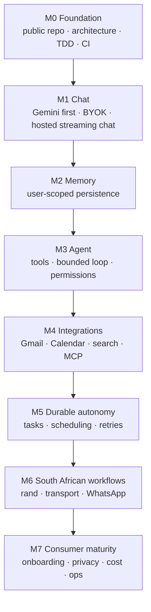

# Roadmap

Status of each milestone is kept honest against [verification.md](verification.md). **Only M0 has any implemented work** — milestones M1–M7 are plans, not implemented behavior. Acceptance criteria define what "done" means for each and may be refined as work proceeds.

## M0 — Foundation (current, partially implemented)

Prove the engineering discipline on a minimal vertical slice before any AI work: a **public repository**, a **two-process architecture** behind an explicit HTTP contract, **test-first development**, and **CI**.

**Implemented so far:** repository contract ([AGENTS.md](../AGENTS.md)), two-process architecture (Java 21 / Spring MVC backend, React + Vite frontend), dual-database configuration — MySQL locally via `application-local.yml`, PostgreSQL in CI/production via `application-prod.yml` — with Flyway versioned migrations, the `GET /api/health` contract with the RFC 7807 error convention, this documentation set, and the CI workflow definition in `.github/workflows/ci.yml`.

**Acceptance criteria — status as observed (see [verification.md](verification.md) for evidence; pending rows are M0's remaining work):**

| # | Criterion | Status |
| --- | --- | --- |
| M0-1 | Architecture proves test-first: backend unit/MVC tests green | ✅ Observed (23 tests after the database-strategy changes) |
| M0-2 | TDD red→green cycle demonstrably executed for the health endpoint | ✅ Observed (red 404, then green) |
| M0-3 | Frontend unit tests, lint, typecheck, build green; standalone Playwright suite green | ✅ Observed (7/7, lint/typecheck/build passed; 4 browser tests) |
| M0-4 | Database verification on both engines (local MySQL suite; PostgreSQL in CI) | ✅ MySQL suite and PostgreSQL migration smoke test passed locally; 🔶 PostgreSQL Testcontainers CI blocked |
| M0-5 | Frontend↔backend browser integration green | ✅ Browser-to-backend tests passed locally against both MySQL and PostgreSQL; CI blocked |
| M0-6 | Dependency audits (frontend high gate; backend OWASP scan in CI) | ⚠️ Frontend high threshold met; 12 moderate minimatch findings remain. Backend scan configured in CI, not yet executed |
| M0-7 | Public hosted repository, pushed history, and **CI green on it** | 🔶 Public repository created and pushed; GitHub Actions blocked by an account billing issue |

## M1 — Chat

The first real product milestone: a hosted, multi-turn streaming chat that people can actually use. **Pstack engineering workflows (TDD cadence, verification-before-merge, focused review) become the working development discipline from M1 onward** — studied from [references.md](references.md).

- Chat backend backed by **Gemini first**, with the provider behind an internal port; **BYOK** (bring your own key) so user credentials are supplied, never stored server-side without explicit consent.
- **Hosted multi-turn streaming chat**: real responses streaming to a working browser UI over the explicit HTTP contract.
- **Conversation persistence** via versioned Flyway migrations that run on both MySQL and PostgreSQL.
- **Accounts / session boundaries** so conversations belong to their owner and are not world-readable.
- **Errors** follow the RFC 7807 convention end-to-end; the browser degrades without crashing.
- **Acceptance:** a real hosted deployment where a browser user signs in, streams a multi-turn conversation with Gemini, and the conversation persists across sessions; backend and browser suites green, including streaming and error paths; CI green.

## M2 — Memory

Give each user persistent, trustworthy memory. **Agent Beacon is the preferred candidate and is evaluated first** (consumer memory ownership, privacy posture, export/deletion guarantees, licensing, cloud-vs-local data flow), with the other [references](references.md) assessed on the same lenses; document the outcome and its trade-offs.

- **User-scoped persistent memory**: memory always belongs to a named user, isolated at the data layer, never shared silently between accounts.
- Remember / retrieve / correct / delete paths, each tested end-to-end including the browser; deletion actually deletes.
- **Provenance and consent**: every memory records where it came from and what the user approved; users can inspect and delete it.
- **Acceptance:** memory CRUD with user scoping, provenance, and consent covered by tests on both engines and in the browser; deletion propagated to connected stores where providers are used.

## M3 — Agent

From chat to acting: a minimal agent that is fully testable without a real LLM.

- **Tool registry and tool calls**: a small set of typed tools with documented schemas.
- **Bounded loop**: planner loop capped in steps, wall-clock **timeout**, and a deterministic stop.
- **Permissions and approval**: every tool behind a server-side least-privilege check; consequential external actions require explicit user approval.
- **Trace**: each run traced (steps, tool calls, approvals) so behavior is auditable.
- **Acceptance:** deterministic fake-LLM tests for the whole loop; no tool executes without its permission check; timeout and bounded-turn behavior covered by tests; traces inspectable.

## M4 — Integrations

Real capabilities beyond chat, each behind least-privilege credentials.

- **Gmail, Calendar, web search, and MCP servers** as the first integrations, implemented against their **documented public APIs** (OAuth scopes narrowed to what each feature needs).
- Untrusted external content validated at the boundary; no silent credential logging.
- **Acceptance:** each integration ships with tests for its API boundary, failure modes, and permission scope; every call traceable per user.

## M5 — Durable autonomy

Long-running work the user can trust even when the server, network, or process fails.

- **Tasks**: user-declared goals tracked across restarts; **scheduling**, **retries** with backoff, and **cancellation** that actually stops work.
- **Recovery and idempotency** so retried work never double-executes consequential actions; **history** of what ran, what changed, and why.
- **Acceptance:** kill-and-recover tests prove tasks resume exactly once; cancellation and idempotency covered by tests; per-task history inspectable in the browser.

## M6 — South African workflows

Regional, practical usefulness — researched first.

- **Budgeting in rand** (local spending habits), **shopping** (price-gathering across local retailers), and **transport** (Gautrain, e-hailing, minibus-taxi contexts) based on real local providers.
- **WhatsApp** integration **only after researching its APIs** (official Meta Business API) and their constraints; if the research shows it is not feasible for a self-serve product, WhatsApp stays out and the decision is recorded.
- **Multilingual / regional awareness** so the agent handles South African contexts, names, and languages in memory retrieval and responses.
- **Acceptance:** each workflow implemented against a documented provider or explicitly cut with recorded reasoning; correctness for rand values, regional content, and language covered by tests.

## M7 — Consumer maturity

Make it something real people can rely on.

- **Onboarding** that works without an engineering background; **reliability** (uptime, error budgets, graceful degradation) and **privacy** (clear data flow, deletion honored everywhere) as product features, not paperwork.
- **Cost visibility and control** for BYOK usage and any running tasks; **authentication** and **operations** runbook finalized.
- **Hosted** offering plus documented, working **self-hosting** (same contract, real deployment path).
- **Acceptance:** hosted and self-hosted paths both pass the full test battery incl. browser E2E; security review complete; roadmap and verification evidence reconciled.
