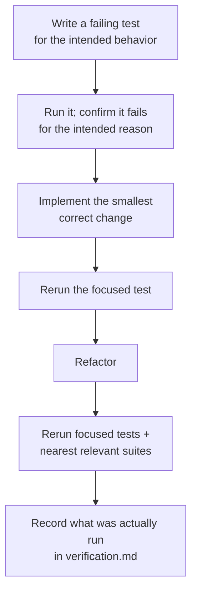

# Testing

Chomiii is built test-first. Write a test for observable behavior, confirm its
failure, implement, then rerun focused and relevant checks. All M1
verification is local. [verification.md](verification.md) records results;
the commands here describe how to reproduce them.



## Backend (`cd backend`)

Uses the Maven Wrapper (`mvnw.cmd` on Windows) so no local Maven install is needed.

Run PostgreSQL API tests against a disposable PostgreSQL database without
Docker. Set `CHOMIII_DB_URL`, `CHOMIII_DB_USER`, and `CHOMIII_DB_PASSWORD`,
then run:

```powershell
.\mvnw.cmd '-Dtest=ChatStreamDatabaseTest,ConversationDatabaseTest,ConversationRestartDatabaseTest,ConversationHostedSecurityTest,ConversationRateLimitTest' test
```

The live Gemini adapter test is opt-in. Set `GEMINI_API_KEY` to an authorized
test key and `CHOMIII_RUN_GEMINI_SMOKE=true`, then run
`.\mvnw.cmd -Dtest=GeminiLiveTest test`. It makes one provider request.
The normal unit suite skips the live test.

To verify the Windows launcher against an isolated local database, run
`npm ci` in `tools/launcher`, then `node smoke.mjs` from that directory. The
test starts two app instances sequentially and reopens a test conversation
after restart. It never touches your normal Chomiii database.

| Command | Runs | Proves | Needs |
| --- | --- | --- | --- |
| `.\mvnw.cmd test` | Unit + MVC-slice tests (Surefire; `*IT` classes excluded) | Behavior of services, controllers via MockMvc, the error contract, config — **no database required** | JDK 21 only |
| `.\mvnw.cmd -Plocal-mysql verify` | Unit/MVC tests **plus** the Failsafe `*LocalIT` suite against the **real local MySQL** (`BackendMySqlLocalIT`) | Real MySQL connectivity, that Flyway migrations apply on MySQL, JaCoCo report (`target/site/jacoco/`) | Local MySQL reachable via `CHOMIII_DB_URL` / `CHOMIII_DB_USER` / `CHOMIII_DB_PASSWORD` (an isolated test database, purely from env vars or `-DCHOMIII_DB_*` system properties). **No Docker** |
| `./mvnw verify` (no profile) | Unit/MVC tests **plus** PostgreSQL Testcontainers integration tests (Failsafe runs `*IT` classes other than `*LocalIT`, e.g. `BackendDatabaseIT` on `postgres:16-alpine`) | Real PostgreSQL 16 connectivity and that Flyway migrations actually apply | **Docker — this is the CI-shaped check, not the local one** |
| `.\mvnw.cmd spring-boot:run` | (_runs the app_ — local profile, MySQL by default) | Manual verification; check `Invoke-RestMethod http://localhost:8080/api/health` | Local MySQL via env vars |

Notable tests as of M0:

- `health/*` — `GET /api/health` contract (`{status:"UP", service:"chomiii"}`); written red (404) before the endpoint existed, then green.
- `error/*` — RFC 7807 problem-detail conventions for validation, built-in MVC errors, and the catch-all 500.
- `database/BackendDatabaseIT` — the PostgreSQL Testcontainers class (the default `verify` path, Docker).
- `database/BackendMySqlLocalIT` + `LocalDatabaseEnvironment` — the real-MySQL local path (profile `local-mysql`, no Docker); the pom defaults exclude `*LocalIT` so plain `verify` stays Docker-only.
- `ApplicationConfigTest`, `DatabaseEngineModulesTest` — prove the profile-file setup (local default, `localhost` MySQL default URL) and that both engine dialect modules are on the classpath so the same migrations can run on either engine.
- Both database paths test the **same migration set** — migrations must stay vendor-compatible (or ship vendor-specific SQL via Flyway variant locations), which is why neither engine's suite is optional evidence.

## Frontend (`cd frontend`)

Run `npm ci` first. These commands use the scripts in
[package.json](../frontend/package.json):

| Command | Runs | Proves |
| --- | --- | --- |
| `npm run test` | Vitest + React Testing Library | Health, provider setup, incremental SSE parsing, submission, stop, error, key removal, and conversation switching. |
| `npm run lint` | ESLint (strict, typescript-eslint) | Code hygiene rules apply to all sources |
| `npm run typecheck` | `tsc --noEmit` on both tsconfigs | Strict type soundness across app and Node configs |
| `npm run build` | typecheck + `vite build` | Production bundle builds (`dist/`) |
| `npm run test:browser` | Playwright, Chromium | Fixture-backed two-turn chat, reload, key removal, mobile layout, and the M0 shell checks. The fixture does not prove Gemini works. |
| `npm run test:browser:integration` | Playwright, Chromium | A running backend health check. With `CHOMIII_RUN_LIVE_CHAT=true` and an authorized `GEMINI_API_KEY`, also runs the real PostgreSQL and Gemini two-turn browser journey. |

The standalone browser suite uses ports `5173` and `5174`. The integration
suite uses `5175`; set `CHOMIII_PUBLIC_ORIGIN=http://127.0.0.1:5175` on the
running backend. The local Gemini key is an environment value, never a test
fixture or command-line argument.

## Docker smoke checks

With Docker installed, set `CHOMIII_DB_PASSWORD` in the shell and run
`docker compose config`, `docker compose up --build -d`,
`docker compose ps`, and `docker compose logs --tail=100`. Check the UI at
`http://localhost:5173`, send a real message with your own key, and restart
the stack without removing its named PostgreSQL volume. These commands were
not runnable on the M1 verification machine because Docker is unavailable.

## Order of operations for a change

1. Write/extend a failing test for the intended observable behavior; confirm it fails for the intended reason.
2. Implement; rerun the focused test, then the nearest relevant regression suites (backend table or frontend table above).
3. Persistence changes warrant local PostgreSQL API tests and
   `.\mvnw.cmd -Plocal-mysql verify` against disposable MySQL. Neither
   engine alone proves both database paths.
4. Record in [verification.md](verification.md) exactly what was run and the outcome; never invent results.

## Dependency audits

Frontend: `npm audit --audit-level=high` is the accepted severity gate. As of 2026-11-03 the **high-severity threshold passes**, while **12 moderate findings remain** in the `minimatch` dependency chain — recorded and consciously accepted at "moderate"; revisit when lockfiles change. Backend: the [CI workflow](../.github/workflows/ci.yml) invokes OWASP dependency-check (`-DfailBuildOnCVSS=7`, no NVD API key configured yet), but it is not configured as a `pom.xml` plugin and **has never actually executed yet** — see [verification.md](verification.md).
