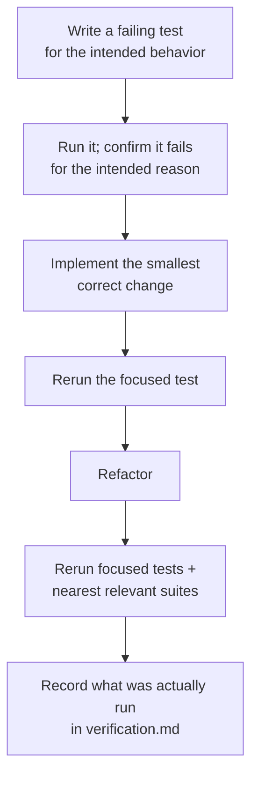
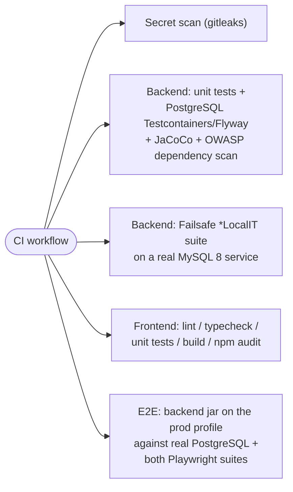

# Testing

Chomiii is built test-first: specify observable behavior, run a test that fails for the intended reason, implement the smallest correct change, refactor, rerun focused tests plus relevant regression checks ([AGENTS.md](../AGENTS.md)). This page lists every check and what it proves, locally and in CI. **The honest record of what has actually been run lives in [verification.md](verification.md)** — check status there before trusting any "green" below.

## Backend (`cd backend`)

Uses the Maven Wrapper (`mvnw.cmd` on Windows) so no local Maven install is needed.

| Command | Runs | Proves | Needs |
| --- | --- | --- | --- |
| `.\mvnw.cmd test` | Unit + MVC-slice tests (Surefire; `*IT` classes excluded) | Behavior of services, controllers via MockMvc, the error contract, config — **no database required** | JDK 21 only |
| `.\mvnw.cmd -Plocal-mysql verify` | Unit/MVC tests **plus** the Failsafe `*LocalIT` suite against the **real local MySQL** (`BackendMySqlLocalIT`) | Real MySQL connectivity, that Flyway migrations apply on MySQL, JaCoCo report (`target/site/jacoco/`) | Local MySQL reachable via `CHOMIII_DB_URL` / `CHOMIII_DB_USER` / `CHOMIII_DB_PASSWORD` (an isolated test database, purely from env vars or `-DCHOMIII_DB_*` system properties). **No Docker** |
| `./mvnw verify` (no profile) | Unit/MVC tests **plus** PostgreSQL Testcontainers integration tests (Failsafe runs `*IT` classes other than `*LocalIT`, e.g. `BackendDatabaseIT` on `postgres:16-alpine`) | Real PostgreSQL 16 connectivity and that Flyway migrations actually apply | **Docker — this is the CI-shaped check, not the local one** |
| `.\mvnw.cmd spring-boot:run` | (_runs the app_ — local profile, MySQL by default) | Manual verification; check `Invoke-RestMethod http://localhost:8080/api/health` | Local MySQL via env vars |

Notable tests as of M0:

- `health/*` — `GET /api/health` contract (`{status:"UP", service:"chomiii"}`); written red (404) before the endpoint existed, then green.
- `error/*` — RFC 7807 problem-detail conventions for validation, built-in MVC errors, and the catch-all 500.
- `database/BackendDatabaseIT` — the PostgreSQL Testcontainers class (the default `verify` path, Docker).
- `database/BackendMySqlLocalIT` + `LocalDatabaseEnvironment` — the real-MySQL local path (profile `local-mysql`, no Docker); the pom defaults exclude `*LocalIT` so plain `verify` stays Docker-only.
- `ApplicationConfigTest`, `DatabaseEngineModulesTest` — prove the profile-file setup (local default, `localhost` MySQL default URL) and that both engine dialect modules are on the classpath so the same migrations can run on either engine.
- Both database paths test the **same migration set** — migrations must stay vendor-compatible (or ship vendor-specific SQL via Flyway variant locations), which is why neither engine's suite is optional evidence.

## Frontend (`cd frontend`)

Run `npm ci` first (install from the lockfile). Commands from [package.json](../frontend/package.json):

| Command | Runs | Proves |
| --- | --- | --- |
| `npm run test` | Vitest + React Testing Library, jsdom | Component behavior, including strict health-response validation and the `VITE_API_BASE_URL` behavior |
| `npm run lint` | ESLint (strict, typescript-eslint) | Code hygiene rules apply to all sources |
| `npm run typecheck` | `tsc --noEmit` on both tsconfigs | Strict type soundness across app and Node configs |
| `npm run build` | typecheck + `vite build` | Production bundle builds (`dist/`) |
| `npm run test:browser` | Playwright, Chromium | **Standalone** shell behavior in a real browser: rendering plus `unavailable` for non-OK, malformed, and unreachable backends (in-browser response interception + a real connection-refused port). Needs **no backend** — passing it does *not* prove backend health |
| `npm run test:browser:integration` | Playwright (`-c playwright.integration.config.ts`) | Real frontend ↔ backend integration. Requires the backend actually running at `BACKEND_URL` and local MySQL behind it; **no skip gate** — a missing/unhealthy backend fails loudly |
| `npm run ci` | Everything above, sequentially | The full local battery (integration browser suite included) |

One no-surprises note: the standalone browser suite spawns dev servers on `5173`/`5174`, so it must not run concurrently with a manually occupied dev server.

## CI (defined in the repository — first run still pending hosting)

The workflow lives in [.github/workflows/ci.yml](../.github/workflows/ci.yml) and will run on push/PR to `main` once the repository is hosted:

So both database engines and the real browser integration are enforced by CI: contributors without Docker get full PostgreSQL verification via CI, while MySQL is also proven locally. Every green claim above stays hypothetical until the hosted repository's first CI run — [verification.md](verification.md) remains the evidence log.

## Order of operations for a change

1. Write/extend a failing test for the intended observable behavior; confirm it fails for the intended reason.
2. Implement; rerun the focused test, then the nearest relevant regression suites (backend table or frontend table above).
3. Backend changes touching persistence additionally warrant **at least one database-engine verification path**: `.\mvnw.cmd -Plocal-mysql verify` locally, and the PostgreSQL suite via CI (or locally with Docker). Neither engine alone counts as both.
4. Record in [verification.md](verification.md) exactly what was run and the outcome; never invent results.

## Dependency audits

Frontend: `npm audit --audit-level=high` is the accepted severity gate. As of 2026-11-03 the **high-severity threshold passes**, while **12 moderate findings remain** in the `minimatch` dependency chain — recorded and consciously accepted at "moderate"; revisit when lockfiles change. Backend: the [CI workflow](../.github/workflows/ci.yml) invokes OWASP dependency-check (`-DfailBuildOnCVSS=7`, no NVD API key configured yet), but it is not configured as a `pom.xml` plugin and **has never actually executed yet** — see [verification.md](verification.md).
